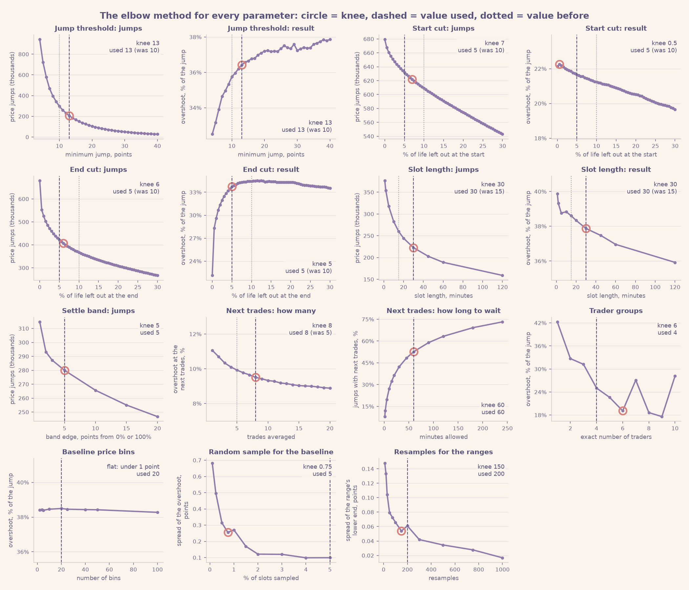

# Jumping to Conclusions: Polymarket Price Jumps Analysis

*An exploratory analysis of 766 million Polymarket trades, November 2022 to May 2026*

Code and plots: [github.com/CrabGuy/PolymarketPriceJumpsAnalysis](https://github.com/CrabGuy/PolymarketPriceJumpsAnalysis)

---

## Contents

1. [In short](#1-in-short)
2. [The data and two ideas](#2-the-data-and-two-ideas)
   - [How the parameters were chosen: the elbow method](#how-the-parameters-were-chosen-the-elbow-method)
3. [The findings](#3-the-findings)
   - [F1. Price jumps overshoot by over a third](#f1-price-jumps-overshoot-by-over-a-third)
   - [F2. Jumps made by many traders stick; jumps made by one trader don't](#f2-jumps-made-by-many-traders-stick-jumps-made-by-one-trader-dont)
   - [F3. A lone trader's push is undone within minutes](#f3-a-lone-traders-push-is-undone-within-minutes)
   - [F4. In a race, a crowd's jump that the other candidates offset is right at once](#f4-in-a-race-a-crowds-jump-that-the-other-candidates-offset-is-right-at-once)
   - [F5. Betting against jumps: a loss after lone pushes, a small edge after crowd jumps](#f5-betting-against-jumps-a-loss-after-lone-pushes-a-small-edge-after-crowd-jumps)
   - [F6. Lone pushes happen in thin markets](#f6-lone-pushes-happen-in-thin-markets)
   - [F7. Sports and esports: the same pattern](#f7-sports-and-esports-the-same-pattern)
   - [F8. Crypto "up or down" markets: the same pattern, over within seconds](#f8-crypto-up-or-down-markets-the-same-pattern-over-within-seconds)
   - [F9. Searching for recurring patterns](#f9-searching-for-recurring-patterns)
   - [F10. News or noise? A tentative look](#f10-news-or-noise-a-tentative-look)
4. [What did not work](#4-what-did-not-work)
5. [Limitations](#5-limitations)
6. [Reference: formulas, methods and parameters](#6-reference-formulas-methods-and-parameters)
7. [Glossary](#7-glossary)
8. [Where the code is](#8-where-the-code-is)

---

## 1. In short

On Polymarket, people bet on events by buying shares that pay $1 if the event happens, so a
share's price is the market's probability for the event. We looked at every sharp price
jump in 766 million trades and asked one question: **judging by how the market finally
resolved, how much of the jump was justified?**

**Just under two thirds.** The rest, a little over a third, is an **overshoot**: noise that
the market later takes back. This holds in every year and every category.

What tells real jumps from noise is **how many different traders made them**:
- A jump made by one trader goes about 40% too far, and the next trades, minutes later,
  undo most of it.
- A jump made by four or more traders goes less than a fifth too far, and that part
  lingers for hours.
- Lone pushes are common where the order book is thin, so that a few dollars can move the
  price.

Once the bid-ask spread is paid, betting against lone pushes loses money. Betting against
crowd jumps, and jumps with over $1,000 behind them, leaves a small edge before fees.

---

## 2. The data and two ideas

### The data

We used every Polymarket trade from November 2022 to May 2026: 766 million trades in about
one million markets, each with a time, a price, a dollar amount and the two wallets
involved. The heavy work ran on a server; small summary tables were analysed on a PC.

Most of the report covers **event markets**: elections, sports, economy, culture, and so on.
That is about 430,000 markets. The recurring crypto "up or down" markets ("Will bitcoin be up in
the next 15 minutes?") behave differently and are covered in [F8](#f8-crypto-up-or-down-markets-the-same-pattern-over-within-seconds).

### Idea 1: a price jump

Here is a real market: *"Will Apple launch another iPhone on February 19?"* (2025), a small
market with 599 trades. On 13 February Tim Cook announced "the newest member of the family"
for 19 February, and Polymarket opened one market per possible product. A separate market
covered an "iPhone SE", the name everyone expected, so this one was in effect a bet on a
different name. It traded near 10% for two days. On Saturday 15 February one trader pushed
it to 70% with no news we could find, and other traders sold it back to 25% by Monday. On
16-17 February reports spread (Bloomberg's Mark Gurman first) that the phone would get a new
name; on the afternoon of the 17th (US time) several traders lifted the price from 28% to
about 70%, and it held. On 19 February Apple announced the **iPhone 16e**: the market
resolved **YES** (and the iPhone SE market NO).

The trades are grouped into 30-minute slots, and each slot gets its average price: each dot
is one slot with trades. A **price jump** (red) is a slot whose price is at least **13
percentage points** away from the previous slot with trades.

Two stretches of each market's life are left out (grey). The life runs from the first trade
to the moment the price leaves 5-95% for good (or to the last trade, if it never does):
- **the first 5%**, while the price is still being found;
- **the last 5%**, the run-up to 0% or 100% that every market makes, which would only
  measure the obvious.

Because both scale with the market, a three-hour game loses about 9 minutes at each end and
a year-long election market about two and a half weeks. In this market that leaves four
jumps: the lone push on the 15th and part of its reversal, and the rise on the 17th, in two
steps. The announcement itself falls in the last 5%.

**How common are price jumps?** 45% of political markets have some; most sports and esports
markets, which are short and many, have none:

Two facts about these jumps matter for everything that follows.

**They involve little money.** The median price jump has $10 traded in its 30 minutes, and
78% have less than $100. A price can jump on a few dollars because, in most markets, few
orders sit near the current price. A small order runs through them and reaches prices far
away.

**Most are made by a single trader "taking liquidity".** Some traders post an order and wait
("I'll sell at 30%"): they are the *makers*. Others accept a posted order immediately: they
are the *takers*, and only takers move the price. So for each price jump we count the
different wallets that took liquidity in its 30 minutes. In 66% of price jumps there is just
one, and that trader spent a median of $4.

### Idea 2: overshoot

Zoom in on Saturday 15 February. At 07:51, in one transaction, a single trader bought $477 of
YES in five fills: four at 15-16% and a last one at 77%, which left the price there. The next
trades were at about 70%, so the 30-minute average jumped from 16% to 70%. No news came out;
by the evening other traders had sold it back to 40%, and by Monday morning it was at 26%.
Most of the jump was given back. (The market still resolved YES, four days later, for a
reason this trader could not have known on Saturday.)

The part of a jump that turns out to be unjustified is the **overshoot**. One market can't
measure it, but thousands can:
1. Take all jumps that ended at, say, 60%.
2. If those prices were right, YES should win 60% of the time.
3. If YES wins only 53% of the time, the prices were 7 points too high.
4. Against a 20-point jump (40% → 60%), that is an overshoot of 7 / 20 = **35% of the jump**.

Prices are slightly off even at quiet moments (YES tends to be a little overpriced), so
that usual error is measured at random moments and subtracted first. An overshoot of 0%
means the jumps were exactly right; a negative one means the price didn't go far enough.

In formulas, for a jump $j$ from price $p_{j^-}$ to $p_j$, with outcome $O_j$ (1 if YES won, 0 if
NO won), direction $d_j$ (+1 up, −1 down) and $b(p)$ the usual error at price $p$:

$$o_j = -\big[(O_j - p_j) - b(p_j)\big] \cdot d_j, \qquad \text{overshoot} = \frac{\sum_j o_j}{\sum_j |p_j - p_{j^-}|}$$

Uncertainty ranges come from resampling whole markets. Every formula used in the report is
listed in [section 6.1](#61-formulas).

**A note on averaging.** Each 30-minute price is volume-weighted: a trade counts in
proportion to its dollars. Weighting only acts *within* a slot, so a slot traded by one
wallet simply gets that wallet's average fill. Re-measuring with plain averages, every trade
counting equally, gives the same conclusions, with crowd overshoots a few points lower.

### How the parameters were chosen: the elbow method

Every number that defines the analysis was checked with the **elbow method**. These are the
jump threshold, the cuts at the start and end of a market's life, the slot length, the settle
band, how the next trades are taken, the trader groups, and the sizes of the samples. For
each one, a curve is drawn over a wide range of values. It shows what the parameter controls:
how many jumps it keeps, or the result itself. Such curves usually change fast at first and
then flatten. The **knee** is where they bend. We find it with the Kneedle rule (Satopää et
al., 2011): the point farthest from the straight line joining the two ends of the curve, with
both axes scaled to 0-1 ([formula](#61-formulas)). Past the knee, moving the parameter further
changes little.

What the elbows gave, and the values used:
- **Jump threshold: 13 points.** Both the number of jumps and the overshoot bend at 13
  points (values tried: 4 to 40).
- **Cut at each end of a market's life: 5%.** Leaving out the end of a market's life raises
  the overshoot fast up to about 5%, and barely after. Before that, the run-up to settling
  is still mixed in: prices racing to 0% or 100% as the outcome becomes known. Cutting the
  start alone hardly changes the result (by about 1 point from 0% to 10%), so it has no
  knee of its own; both ends use 5%, the knee of cutting both together.
- **Slot length: 30 minutes.** Among slots of 1 minute to 2 hours, both the number of jumps
  and the overshoot bend at 30 minutes.
- **Next trades: the first 8 trades, within 1 hour.** The overshoot at the next trades keeps
  falling slowly as more trades are averaged and bends at 8. The share of jumps that have
  next trades bends at 1 hour.
- **Settle band: 5-95%.** The knee is at 5 points from 0% or 100%.
- **Trader groups: 1, 2-3, 4+.** The overshoot falls up to about four traders and is flat,
  within noise, after; the knee lies between 4 and 6.
- **Baseline: 20 price bins from a 5% random sample.** The result does not depend on the
  number of bins (it moves by under 0.3 points from 2 to 100 bins). The sample's knee is
  at 0.75% of slots; 5% is past it, which only makes the baseline steadier.
- **Resamples for the uncertainty ranges: 200-300.** The knee is at 150.

The knees were found one parameter at a time, with the others at the values used before
(10 points, 10%, 15 minutes, 5 trades); the analysis was then rerun with the knee values.
One caveat: a count that falls off smoothly has no sharp bend, so its knee moves with the
range of values tried (the threshold's from 9 to 13 points as the range grows from 20 to 40
points). Between the old values and the knees, each result moved by about 1 point or less.

---

## 3. The findings

### F1. Price jumps overshoot by over a third

Across 191,065 price jumps in 59,536 markets with a clear outcome, the price right after a
jump is on average **too extreme by 36% of the jump** (range 35.0-36.0%).

The plot shows it without any formula. For jumps that ended at a given price (x-axis), it
shows how often YES actually won (y-axis):
- after an **up** jump to about 60%, YES won only 45% of the time;
- after a **down** jump to about 60%, YES won 62% of the time;
- at random moments, a 60% price won 57% of the time.

After a jump, the price sits too far in the direction of the jump.

It is between 31% and 40% in every category and every year, and at any distance from the
market's end. It is highest for jumps starting below 20% (47%):

The size varies by topic. Across 103 tags it ranges from 9% to 52%. Markets on stock prices
(Amazon, Meta, Tesla) and weekly or daily price markets are at the low end; UFC, earnings,
the UK, the Premier League and the trade war at the high end.

---

### F2. Jumps made by many traders stick; jumps made by one trader don't

The best predictor of overshoot is **how many different traders took liquidity in the
jump's 30 minutes**.

**Trader by trader.** 66% of price jumps are made by a single trader, 13% by two and 6% by
three; the remaining 15% are spread over four traders and more, up to several hundred. The
overshoot falls from 43% with one trader to 36% with two, 31% with three and 24% with four.
From four traders on, each count has under 6,000 jumps and the values scatter (3% to 33%)
with wide, overlapping ranges; together they overshoot 18%. So the report groups traders as
1, 2-3 and 4+.

Two real jumps show the contrast:
- **Left:** on 21 January 2025, one trader paid $244 in 5 fills and pushed "Will Aryna
  Sabalenka win the Australian Open?" from 38% to 62%. The next trades, 74 seconds later,
  were at 29%, and the market resolved NO (she lost the final).
- **Right:** on 30 January 2026, 88 traders put $27,400 into "Will Carlos Alcaraz win the
  2026 Australian Open?" and moved it from 14% to 35%. The price held and kept rising over
  the next hours, and the market resolved YES.

The pattern is robust:
- **At the same money.** In every money band, one trader's jumps overshoot the most. Above
  $500 the gap is widest: 42% for one trader against 18% for four or more.

  

- **For every definition of a price jump:** 5-, 30- or 60-minute slots, and jumps of at
  least 8, 13 or 18 points.

  

- **With everything else held fixed.** A regression holds category, question type, money,
  price level, time to the end, market lifetime, year and direction fixed at once. Crowd
  jumps still overshoot 21 points less than single-trader jumps, against 24 points raw.

  

- **It's not a handful of wallets.** The 126,000 single-trader jumps come from 56,000
  wallets. A wallet's overshoot in the first half of its history barely predicts the second
  half.

  

- **Do lone pushes point the right way?** A jump points the right way if it went up and YES
  won, or went down and NO won. Single-trader jumps did so 52.9% of the time. Had the price
  before the jump been right, they would have done so 38.5% of the time; had the price after
  it been right, 63.8%. So a lone push does carry information: it points the right way more
  often than the old price implied, but less often than the new price claims. It covers
  (52.9 − 38.5) / (63.8 − 38.5) = 57% of the way, which is the 43% overshoot seen from
  another angle. Crowd jumps (4+) point the right way 57.8% of the time, against 40.1% and
  62.0%: 81% of the way.

  

**What it means.** Agreement between several independent traders is a much better sign of
information than the size of a jump.

---

### F3. A lone trader's push is undone within minutes

Following the same jumps over time (those with prices a day later):
- **One trader:** the overshoot falls from 43% to **9% at the very next trades**.
- **Four or more traders:** it starts lower (28%) but lingers. It is still 22% at the next
  trades and 17% after an hour, and gone (0%) after a day.

"Next trades" means the first eight trades after the 30 minutes. They come a median of 2
minutes after crowd jumps and 19 minutes after single-trader jumps, which happen in quieter
markets.

**One jump at a time.** The overshoot is an average: with an outcome that is either 0 or 1,
it cannot be read off a single jump. What can be measured jump by jump is how much of it the
next trades gave back. For the 41,801 single-trader jumps whose market traded again within
the hour (33% of them), the answer is spread out:
- 29% were taken further by the next trades;
- 17% were kept as they were (0-10% given back);
- 37% lost at least half, and 16% lost all of it or more;
- the median jump gave back 17%; weighted by size, 35% of the jump was given back.

So the snap-back is not every lone push losing a bit: some are reversed completely, while
others are kept or extended.

**What it means.** A lone trader's push is mostly temporary *price impact*: one order walks
the price through a thin book, and the next traders bring it back. A crowd's smaller
overshoot is a slower over-reaction.

---

### F4. In a race, a crowd's jump that the other candidates offset is right at once

Many questions on Polymarket are races: who wins an election, which team wins a league.
Each candidate is its own market, and exactly one of them will win. Most of these races are
**neg-risk** events (a flag in the data): a NO share in one candidate can be converted into
YES shares of all the others. This links the candidates' prices, so that their YES prices add
up to about 100%, and it gives liquidity even to the long shots.

So when one candidate jumps, the others should fall by about as much in total. For each of
the 24,353 price jumps in neg-risk events, we checked what the other candidates did in the
same 30 minutes. They either **offset** the jump (moved the other way by at least 75% of it),
**partly** offset it (25-75%), did **not** offset it, or did not trade at all.

- A **crowd's jump** (4+ traders) that the others offset is right at once: −3% at the end of
  the 30 minutes (range −11% to +5%). Without the offset it overshoots by 41%, and by 46% if
  no other candidate traded.
- For a **lone trader's** jump the offset makes no difference: 33-45% either way.
- By the **next trades** the difference is gone: crowd jumps are 16-17% too far, offset or not.

**What it means.** In a race, a crowd jump that the rest of the field confirms by repricing
is right at once. A jump the rest of the field ignores goes too far until the next trades
correct it. Outside neg-risk events (48,000 jumps), offset jumps are no better (36% against
25% overshoot), but there the markets of an event need not exclude each other, so an "offset"
means little.

---

### F5. Betting against jumps: a loss after lone pushes, a small edge after crowd jumps

If jumps overshoot, betting against them should pay. Each test bet buys the opposite side
right after the jump, at the price a bettor would actually have paid, and holds it to the
end. Returns are measured per $1 staked, net of the usual pricing error. Bets are placed
only when the jump started between 5% and 95%, because below that the opposite side costs a
few cents and a single win pays 20 times the stake.

Even so, a few very large wins dominate the plain averages. With the most extreme 1% at each
end trimmed:

- **After single-trader jumps, betting against them loses** about 7 cents per $1 (range 5-10).
  The fast snap-back happens, but the bid-ask spread (a median 6.3 cents) eats it.
- **After crowd jumps (4+ traders), it gains** about 7 cents per $1 (range 5-10), where the
  spread is only 2.0 cents.
- **After jumps with over $1,000 behind them, it gains** about 17 cents per $1 (range 14-21).

**What it means.** The large overshoot of lone pushes is gone before anyone can trade on it.
What a bettor can capture is the smaller overshoot of crowd and big-money jumps, which the
next trades leave in place (F3). Fees and queue position are not modelled, so this is an
upper bound.

---

### F6. Lone pushes happen in thin markets

Some markets see single-trader jumps all the time, others never. For each of 99,198
markets with at least 20 active slots, standard market-structure measures were computed:
- how concentrated trading is among wallets (Gini, Herfindahl, the biggest wallet's share);
- how far $1,000 of net buying moves the price (Kyle's lambda);
- the bid-ask spread (Roll's estimator, and the buy-sell price gap within a minute);
- how balanced buying and selling are.

- **How often one trader can push the price depends on how thin the book is.** With market
  size held fixed, it correlates with the spread (+0.52) and with the price impact per
  dollar (+0.17).
- **Concentration among a few wallets doesn't explain it** (Gini −0.15: if anything, the
  opposite).
- **This holds in every category.**
- **How far the push goes doesn't depend on the market:** one-trader jumps overshoot 41-48%
  in every fifth of the markets, on every measure (right panel).

Across 199 tags the link is strong (+0.60). TSA, mention markets, stock and equity markets
are at the top; football leagues and world elections at the bottom.

---

### F7. Sports and esports: the same pattern

Sports and esports make up most markets but have the fewest jumps per market: 69,578 price
jumps in 31,445 markets with a clear outcome. Because the left-out stretches scale with each
market's life, a game market keeps its game. The data has no kickoff times, so jumps before
and during a game are not told apart.

- **Lone pushes overshoot as everywhere else** (43% in sports, 45% in esports), and the next
  trades undo them.
- **Crowd jumps overshoot less** (21% and 16%), but 16-18% is still there at the next
  trades, which come within a minute or two.

By sport, the overshoot ranges from 22% (Dota) to 51% (combat sports):

**What it means.** Game markets behave like every other market.

---

### F8. Crypto "up or down" markets: the same pattern, over within seconds

These recurring markets (bitcoin, ether, solana and xrp, over 5 minutes, 15 minutes or 1
hour) hold 59% of all trades. Measured on 1-minute slots: 233,484 price jumps in 104,958
markets. Only the stretch after the price settles is left out here: a cut by share of the
life would remove most of these markets' jumps (70% when tested at 10%).

At the end of the minute the familiar pattern appears: lone pushes go too far (+10% to +16%)
and crowd jumps keep going (−16% to −29%). By the next trades, a second or two later, every
group is within about ±5%: nothing is left to exploit.

A related market decides the direction. A crowd jump keeps going when the other coin's market
of the same length moved the same way in that minute (−29%), and reverses when it moved the
other way (+14%).

---

### F9. Searching for recurring patterns

We also looked for recurring shapes with *matrix profiles*, a standard pattern-search tool
for time series. Price paths after price jumps show **almost no recurring shape beyond chance**:
5.7% of real paths have a close match elsewhere, against 5.0% of shuffled ones. In the chain of
bitcoin's 15-minute markets, the unusual stretches are "whipsaw" markets where the price
crosses 50% about six times. Comparing the coins' chains shows that their markets move
together, with bitcoin and ether about 30 seconds ahead of solana and xrp. All of this is
real but has plain explanations, and none of it is tradable.

---

### F10. News or noise? A tentative look

A last, less conclusive check: can one tell a jump that carries news (many traders, a lasting
effect) from one trader's noise?

After the fact, partly. What the next trades within the hour do to a jump says more than who
made it. Jumps the next trades took further were about right at the close; jumps they
reversed were wholly unjustified. This holds for every trader group. A jump with 4+ traders
that the next trades kept had no overshoot at all (0%, range −3% to 3%). A one-trader jump
that the next trades mostly gave back had 75%.

At the moment of the jump, though, the signs are weak. The number of traders helps most (18%
overshoot with 4+ traders, 41% without). A new trade within five minutes helps too (25%
vs 40%), and so does $1,000 or more (26% vs 39%). Another market of the same event jumping
at the same time does not help (36% vs 38%). And 67% of one-trader jumps have no trade at all
in the following hour, so for most lone pushes the after-the-fact test cannot be applied. This
is a description, not a tool.

---

## 4. What did not work

- **Recurring price shapes across markets.** Real matches were barely more common than
  chance.
- **"Price moved without money" anomalies.** Mostly bid-ask bounce: trades alternating
  between the buy and the sell side.
- **"More trades means more reversal".** An artefact of using the last trade price: a sweep's
  last fill is its most extreme price. Fixed by using slot averages.
- **"Bet against crypto YES spikes".** It was just crypto YES being about 8 points overpriced
  in general. Fixed by measuring the usual error per category.
- **Concentration (Gini) as the cause of lone pushes.** With size and price impact held
  fixed, it adds nothing.
- **Bitcoin anomalies clustering at US data-release hours.** This did not hold up.
- **Splitting game markets into before and during the game.** The data has no kickoff
  times, and the end date is not a reliable stand-in (esports matches often settle hours
  before it), so no such split is made.

---

## 5. Limitations

- **"Next trades" is an average of real trades, not a guaranteed price.** F5 uses
  side-specific prices, but fees and queue position are not modelled.
- **The usual-error correction is estimated from the data**, per category or question type.
  Other ways of estimating it move the levels by 1-3 points without changing any comparison.
- **Most jumps are small in money.** The findings describe how prices behave, not a large
  pool of money.
- **The last 5% of a long market is left out.** For an election market that is its final
  weeks, when much of the news arrives.
- **Approximate labels.** Categories and question types come from text rules.
- **No external data.** There are no news timestamps or live scores, so "confirmation" always
  means other Polymarket prices.

---

## 6. Reference: formulas, methods and parameters

### 6.1 Formulas

Notation: trade $i$ has a time $t_i$, a YES price $y_i$, a dollar amount $u_i$ and a taker
wallet $w_i$. A market's final outcome is $O = 1$ if YES won and $O = 0$ if NO won.

**YES price of a trade.** Each trade is in one of the two tokens of a market:

$$y_i = \begin{cases} \text{price}_i & \text{token 1 (YES)} \\ 1 - \text{price}_i & \text{token 2 (NO)} \end{cases}$$

**Slot price.** Slot $s$ holds the trades with $\lfloor t_i / \Delta \rfloor = s$, $\Delta$ = 30 minutes. Its
price is the volume-weighted average (VWAP), its money and its number of traders are

$$p_s = \frac{\sum_{i \in s} u_i \, y_i}{\sum_{i \in s} u_i}, \qquad U_s = \sum_{i \in s} u_i, \qquad K_s = \left|\{ w_i : i \in s \}\right|$$

**Price jump.** With $s^-$ the previous slot of the same market that had trades, and the price
clipped to $\tilde p = \min(\max(p, 0.01), 0.99)$,

$$\Delta p_s = \tilde p_s - p_{s^-}, \qquad \text{slot } s \text{ is a price jump if } |\Delta p_s| \ge \theta, \quad \theta = 0.13$$

The direction is $d_s = \operatorname{sign}(\Delta p_s)$ (+1 up, −1 down).

**Life and window.** A market's life runs from its first slot $t_\text{first}$ to its end
$t_\text{end}$: the last slot whose last trade lies inside $[\varepsilon, 1 - \varepsilon]$, $\varepsilon = 0.05$, when the
market ends outside that band; otherwise its last slot. The position of slot $s$ in the life is

$$f_s = \frac{t_s - t_\text{first}}{t_\text{end} - t_\text{first}}$$

and a slot is kept if $c_\text{start} \le f_s \le 1 - c_\text{end}$, with $c_\text{start} = c_\text{end} = 0.05$.

**Outcome.** From the first outcome price $q$ of the market: $O = 1$ if $q > 0.99$, $O = 0$ if
$q < 0.01$; otherwise the market is left out.

**Usual error (baseline).** At random slots $r$ (a 5% sample of all kept slots), per category
$c$ and per price bin $B$ of width 0.05:

$$b_c(B) = \frac{1}{|R_{c,B}|} \sum_{r \in R_{c,B}} (O_r - p_r)$$

**Overshoot of one jump** $j$, measured at a later price $p$ (the close $p_j$, the next trades, or
the price $h$ hours later), in price points:

$$o_j(p) = -\big[(O_j - p) - b_c(p)\big] \cdot d_j$$

It is positive when the outcome landed on the other side of $p$ from the jump, beyond the
usual error.

**Overshoot share** of a group $J$ of jumps (the number the report calls "overshoot"):

$$\mathrm{OS}(J) = \frac{\sum_{j \in J} o_j(p)}{\sum_{j \in J} |\Delta p_j|}$$

0% means the jumps were right on average; 100% means the whole jump was unjustified; below
0% means the price did not go far enough. A single jump's $o_j / |\Delta p_j|$ is not
informative on its own: the outcome is 0 or 1, so it is either far above or far below zero.
Only the share over many jumps is.

**Next trades.** The first $N = 8$ trades of the market after the slot closes, within
$T = 1$ hour:

$$p^\text{next}_j = \frac{\sum_{k=1}^{N} u_k \, y_k}{\sum_{k=1}^{N} u_k}$$

**How the price settles after a jump (F3).** With $\ell(p) = \log \frac{p}{1-p}$, the share of the
jump still in the price $h$ hours later, using the last slot with trades before $t_j + h$:

$$R_j(h) = \frac{\ell(p_{t_j + h}) - \ell(p_{j^-})}{\ell(p_j) - \ell(p_{j^-})}, \qquad h \in \{1, 6, 24\} \text{ hours}$$

The decay curve is $\mathrm{OS}$ evaluated at $p = p^\text{next}_j$ and at $p = p_{t_j + h}$, on the same jumps.

**Share of a jump given back** by the next trades:

$$g_j = \frac{p_j - p^\text{next}_j}{p_j - p_{j^-}}$$

$g = 0$: the next trades kept the jump; $g = 1$: they undid all of it; $g < 0$: they went further.

**Pointing the right way.** A jump points toward the outcome if it went up and YES won, or
down and NO won:

$$A(J) = \frac{1}{|J|} \sum_{j \in J} \mathbb{1}\big[d_j = 2 O_j - 1\big]$$

compared with the rate expected if the price after the jump were right,
$E_\text{after} = \frac{1}{|J|}\sum_j \big(p_j \text{ if } d_j = +1 \text{, else } 1 - p_j\big)$, and the same with the price
before the jump, $E_\text{before}$.

**Ranges.** Markets are resampled with replacement $M$ times ($M$ = 200-300); the range is the
2.5th to 97.5th percentile of the $M$ values of $\mathrm{OS}$ (5th to 95th for the F1 headline).

**All factors at once (F2).** Weighted least squares over jumps, weight $|\Delta p_j|$:

$$\frac{o_j(p_j)}{|\Delta p_j|} = \beta_0 + \beta_{2\text{-}3} \mathbb{1}[K_j \in \{2, 3\}] + \beta_{4+} \mathbb{1}[K_j \ge 4] + \sum_k \gamma_k x_{jk} + e_j$$

where the $x_{jk}$ are dummies for question type, category, money band, price band, time to
the end, market lifetime, year and direction. With the weights, $\beta_0 + \beta$ reproduce the
overshoot shares.

**Wallets (F2).** For each wallet with at least 10 single-trader jumps, $\mathrm{OS}$ over the first
half of its jumps (in time) and over the second half; the figure reports their correlation.

**Other candidates (F4).** For a jump $j$ in a neg-risk event, with $\Delta p_m$ the price changes of
the other candidates $m$ in the same 30 minutes:

$$\phi_j = -\frac{\sum_{m \ne j} \Delta p_m}{\Delta p_j}$$

Groups: no other candidate traded; $\phi < 0.25$ (not offset); $0.25 \le \phi < 0.75$ (partly); $\phi \ge 0.75$ (offset).

**Betting against a jump (F5).** Enter at $e_j$, the VWAP of the first 8 trades on the bettor's
side within 1 hour: after an up jump buy NO at $1 - e_j$, after a down jump buy YES at $e_j$, and
hold to the end. Return per $1 staked:

$$\rho_j = \frac{d_j \, (e_j - O_j)}{\sigma_j}, \qquad \sigma_j = \begin{cases} 1 - e_j & d_j = +1 \\ e_j & d_j = -1 \end{cases}$$

"Net" adds back the usual error, $\rho_j + d_j\, b(e_j) / \sigma_j$. Only jumps with $0.05 \le p_{j^-} \le 0.95$;
returns clipped at the 1st and 99th percentile of all bets; the mean is reported.

**Market structure (F6)**, per market with at least 20 slots with trades:
- Kyle's lambda $\lambda$: the slope of $\Delta \ell_s = \alpha + \lambda \, F_s + e_s$ over consecutive slots at most 2 h
  apart, with $F_s$ the net taker buying of YES in $1,000s;
- Roll spread: $2\sqrt{-\operatorname{cov}(\Delta p_t, \Delta p_{t-1})}$ over consecutive trades (0 if the covariance is positive);
- Gini and Herfindahl $H = \sum_w s_w^2$ of the taker wallets' dollar shares $s_w$, and the top wallet's share;
- the target: the share of the market's price jumps made by a single trader.
Correlations are Spearman's, partial on the log of traders, dollars and slots.

**Crypto up/down (F8).** As above with $\Delta$ = 1 minute, next trades within 5 minutes, and a
window cut only at the settle moment. The other coin "moved" in the same minute if
$|\Delta \ell| \ge 0.1$.

**Matrix profile (F9).** For windows $T_a$, $T_b$ of length $m$, with means $\mu$, standard
deviations $\sigma$ and correlation $\rho_{ab}$, the z-normalised distance and the profile are

$$D(a, b) = \sqrt{2m\,(1 - \rho_{ab})}, \qquad P_a = \min_{b \text{ in another event}} D(a, b)$$

A path "has a close match" if $P_a < R$, with $R$ the 5th percentile of the profile of the
shuffled paths.

**Signs at the time of a jump (F10).** crowd $K_j \ge 4$; money $U_j \ge \$1{,}000$; co-jump: another
market of the same event jumped in the same slot; follow-up: a trade within 5 minutes of the
slot's close. After the fact, by $1 - g_j$, the share of the jump the next trades kept:
reversed fully ($< 0$), gave back over half ($0$ to $0.5$), kept over half ($0.5$ to $1$), went further ($> 1$).

**Elbow (knee) of a curve** $(x_k, y_k)$, $k = 0 \dots n$ (Kneedle, Satopää et al. 2011). Scale both axes
to [0, 1], $\hat x_k = \frac{x_k - \min x}{\max x - \min x}$ and the same for $\hat y_k$; the knee is the point farthest from
the straight line through the first and last points:

$$k^\ast = \arg\max_k \frac{\big|(\hat y_n - \hat y_0)(\hat x_k - \hat x_0) - (\hat x_n - \hat x_0)(\hat y_k - \hat y_0)\big|}{\sqrt{(\hat x_n - \hat x_0)^2 + (\hat y_n - \hat y_0)^2}}$$

### 6.2 Data and price jumps

| Step | Choice |
|---|---|
| Markets | all event markets with trades; recurring crypto up/down markets analysed separately (F8) |
| YES price per trade | `price` if the traded token is token 1, else `1 - price` |
| Slots | **30 min** (main); 5 and 60 min as checks; **1 min** for crypto up/down |
| Slot price | volume-weighted average (VWAP); checked against the plain average of trades |
| Price scale | log-odds `log(p / (1 - p))`, p clipped to [0.01, 0.99] |
| **Price jump** | a slot whose price is ≥ **13 points** from the previous slot with trades (checks: 8 and 18) |
| Window | a market's life runs from its first slot to the last slot inside [5%, 95%] when it ends outside that band (else to its last slot); the first and last **5%** of it are left out. F8: only the slots after that last slot are left out |
| Outcome | first outcome price > 0.99 → YES, < 0.01 → NO, otherwise the market is left out |
| Categories, question types | first match of a text rule on the tags / question |

### 6.3 Overshoot and statistics

| Item | Choice |
|---|---|
| Usual error (baseline) | mean (outcome - price) in 20 price bins of 5 points, at random moments (a 5% sample of slots); pooled for F1, per category for F2-F3 and F7, per question type for F4-F5, per coin and length for F8 |
| Overshoot | `-((outcome - p) - baseline(p)) × sign(jump)` at any later price p; shared as Σ overshoot / Σ \|jump\| |
| Next trades | the first **8 trades** after the slot, within **1 h** (5 min for crypto) |
| Trader groups | distinct taker wallets in the jump's slot: **1 / 2-3 / 4+** |
| Uncertainty | resampling whole markets, 200-300 times |
| All factors at once (F2) | weighted least squares, weight \|jump\|; dummies for traders, question type, category, money, price band, time to end, lifetime, year, direction |
| Wallets (F2) | wallets with ≥ 10 single-trader jumps; overshoot in the first vs second half of their history |
| Betting against jumps (F5) | entry = first 8 trades on the bettor's side within 1 h; return per $ = sign × (entry - outcome) / stake; jumps starting between 5% and 95%; returns trimmed at the 1st and 99th percentile |
| Market structure (F6) | markets with ≥ 20 active slots; Kyle's lambda = slope of the slot's price change on net buying (consecutive slots ≤ 2 h apart, ≥ 20 slots); Roll spread; Spearman correlations controlling for traders, money and slots |
| Other candidates (F4) | neg-risk events (`neg_risk` = 1); offset = −(sum of the other candidates' price changes in the slot) / the jump; groups: none traded, < 25%, 25-75%, ≥ 75% |
| Crypto (F8) | other coin = ether for bitcoin, bitcoin for the others; "moved" = ≥ 0.1 log-odds in the same minute |

### 6.4 Pattern search (F9)

| Search | Series | Window | Distance | Chance comparison |
|---|---|---|---|---|
| After price jumps | 55 five-minute prices per jump (−35 min to +4 h), 19,226 jumps with ≥ 6 h of the window left | 55 | z-normalised; matches must be in another event; paths need ≥ 8 price changes | post-jump steps shuffled |
| Bitcoin chain | bitcoin 15-min markets back to back, 30 points each (673,620 points) | 30 | z-normalised, `stumpy.stump` | profile vs 200 shuffles |
| Coin pairs | the 4 coins' 15-min chains, AB-joins | 30 | `stumpy.stump(T_A, 30, T_B)` | other coin shuffled in time |

### 6.5 Computing and plots

- **Server:** each extraction step runs on 2 threads within 8 GB of memory. Regrouping the
  766 million trades takes one pass of about 30 minutes.
- **Plots:** Python with numpy, pandas, scipy, stumpy and matplotlib, in the Rose Pine Dawn
  theme. The trader groups have fixed colours: 1 trader = rose-red, 2-3 = gold, 4+ = pine blue.

---

## 7. Glossary

| Term | Meaning |
|---|---|
| **YES price** | Price of the share that pays $1 if the event happens; read as a probability |
| **Log-odds** | `log(p / (1 - p))`; stretches the scale near 0% and 100% |
| **Slot** | A 30-minute window in which trades are grouped |
| **Price jump** | A slot whose price is ≥ 13 points from the previous slot with trades |
| **Life of a market** | From its first trade to the moment its price leaves 5-95% for good (or its last trade); the first and last 5% are left out |
| **Maker / taker** | The maker posted an order and waited; the taker accepted it, moving the price ("taking liquidity") |
| **Overshoot** | The part of a jump that the final outcome did not justify, beyond the usual error, as a % of the jump |
| **Next trades** | The first eight trades after a jump |
| **Neg-risk event** | A Polymarket race whose candidates exclude each other; a NO share in one converts into YES shares of all the others, which links their prices and gives the long shots liquidity |
| **Spread** | The gap between the price to buy and the price to sell |
| **Kyle's lambda** | How far $1,000 of net buying moves the price |
| **Gini / Herfindahl** | Measures of how concentrated trading is among wallets |
| **Matrix profile** | For every window of a series, the distance to its most similar other window |

---

## 8. Where the code is

| Step | Scripts |
|---|---|
| Server extraction | `remote/s1_bucket.py` (regroup trades), `s2_events.py` / `s3_events.py` (slots, window and jumps), `s4_paths.py` (price paths, crypto jumps), `s6_micro.py` (market structure), `s7_events.py` (plain averages), `s8_wallets.py` (wallets and other candidates), `p7_extract.py` (example market) |
| F1-F3 | `explore/r02_persistence.py`, `r03_robustness.py`, `r04_types.py`, `r07_basis.py` |
| F2 regression | `explore/r05_event_markets.py` |
| F4 | `explore/r08_pairs.py`, `r07_siblings.py` |
| F5, F6 | `explore/r06_fade.py`, `r08_fade_robust.py`, `r06_concentration.py` |
| F7, F8 | `explore/r07_sports.py`, `r05_updown.py` |
| F9 | `explore/r04_motifs.py`, `r04_btc_chain.py`, `r05_crypto_mp.py` |
| F10 | `explore/r10_information.py` |
| Parameters (elbow) | `remote/s11_elbow.py`; `explore/r11_elbow.py` |
| Traders one by one, give-back, pointing the right way | `explore/r11_traders.py` |
| Definition checks | `remote/s9_window.py`, `s9_variants.py`; `explore/r09_threshold.py`, `r09_window.py`, `r09_sweep.py`, `r09_crypto.py`, `r08_filters.py` |
| This report | `explore/report_stats.py`, `report_figures.py`, `report_style.py` |

**Related work:** Tsang & Yang, "Political Shocks and Price Discovery in Prediction Markets"
and "The Anatomy of Polymarket" (arXiv 2603.03152, 2603.03136); Akey, Vincent, Harvie &
Martineau, "Who Wins and Who Loses in Prediction Markets? Evidence from Polymarket" (CEPR DP
21615, 2026); Roll (1984).
