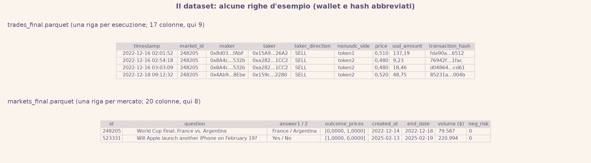
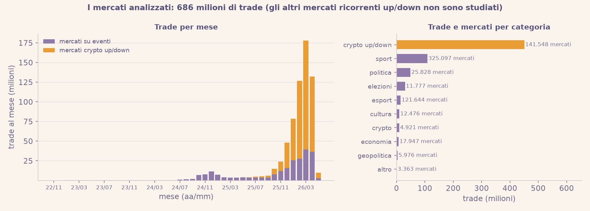
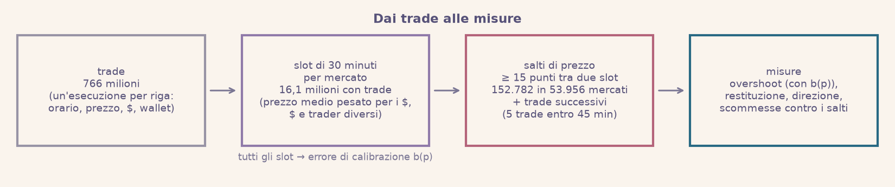
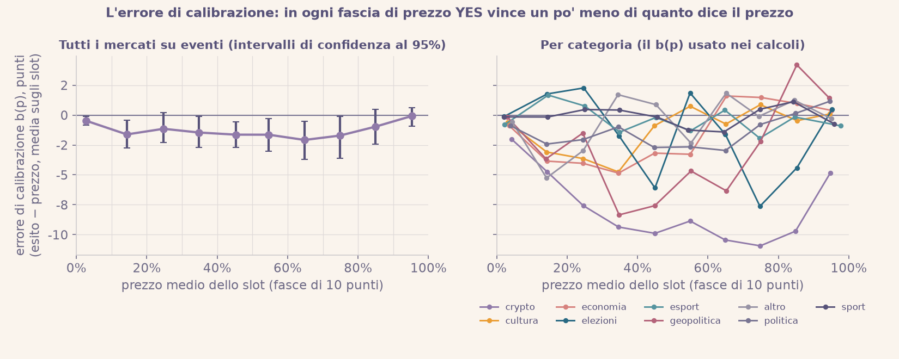
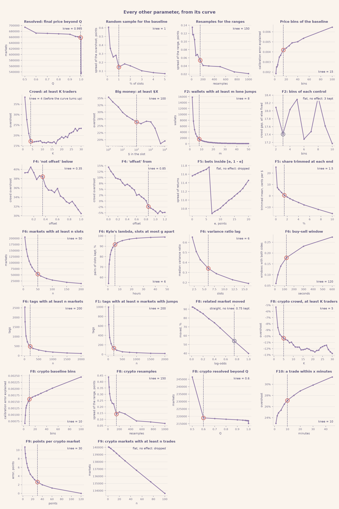
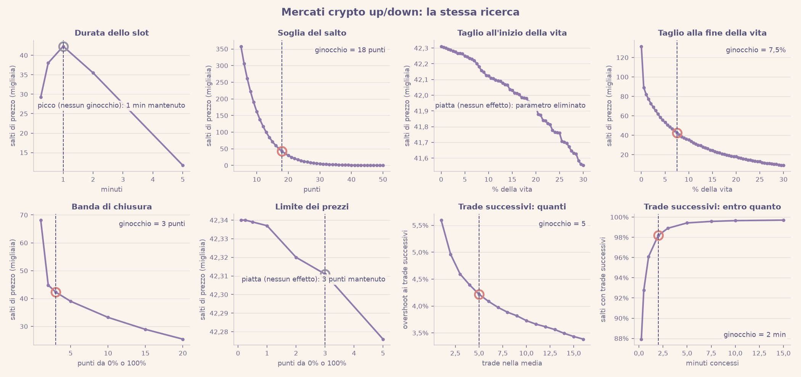

# Salti di prezzo su Polymarket: versione semplificata

*Analisi di 766 milioni di trade su Polymarket, da novembre 2022 a maggio 2026*

---

## 1. Contesto

Polymarket è un mercato di previsioni: si scommette su un evento comprando quote che pagano
$1 se l'evento si verifica (YES) e $0 se non si verifica (NO). Il prezzo di una quota, compreso
tra 0% e 100%, è quindi la probabilità che il mercato attribuisce all'evento.

Abbiamo usato tutti i trade di Polymarket da novembre 2022 a maggio 2026: 766 milioni di scambi
in circa un milione di mercati. Di ogni trade sono noti l'orario, il prezzo, l'importo in dollari
e i due wallet coinvolti. L'analisi riguarda i mercati su eventi (politica, sport, economia,
cultura, ecc.), circa 440.000; i mercati crypto "up or down" sono trattati a parte (sezione 5).
Dei 766 milioni di trade, 235 milioni sono nei mercati su eventi e 451 milioni nei mercati crypto
"up or down" della sezione 5; i restanti 80 milioni appartengono ad altri mercati ricorrenti "up
or down" (altre monete e durate), non studiati.

La domanda è una sola: **quando il prezzo fa un salto improvviso, quanta parte del salto era
giustificata, alla luce di come il mercato si è poi risolto?**

---

## 2. Salti di prezzo e overshoot

### Salto di prezzo

I trade vengono raggruppati in intervalli di 30 minuti, detti **slot**. Il prezzo di uno slot è
la media dei prezzi dei suoi trade, pesata per i dollari scambiati (VWAP):

$$p_s = \frac{\sum_{i \in s} u_i \, y_i}{\sum_{i \in s} u_i}$$

dove $y_i$ è il prezzo YES del trade $i$ e $u_i$ il suo importo in dollari.

Uno slot è un **salto di prezzo** se il suo prezzo dista almeno **15 punti percentuali** da
quello dello slot precedente in cui ci sono stati trade:

$$|p_s - p_{s^-}| \ge 15 \text{ punti}$$

È l'idea dei test a soglia sugli incrementi dei processi con salti (Mancini 2009): un incremento
tra due osservazioni più grande di una soglia segnala un salto. Lì la soglia dipende dal passo di
campionamento; qui il passo è fisso (30 minuti) e la soglia è scelta con il metodo del gomito
(sezione 3).

Di ogni mercato si escludono il primo 7% della vita, quando il prezzo si sta ancora formando, e
l'ultimo 4,5%, cioè la corsa finale verso 0% o 100% che compiono tutti i mercati.

Per ogni salto si guardano anche i **trade successivi**: il prezzo medio (pesato per i dollari) dei
primi 5 trade dopo la fine dello slot, entro 45 minuti.

**Esempio.** *"Will Apple launch another iPhone on February 19?"* (2025). Il 15 febbraio un solo
trader, con meno di 100 dollari, porta il prezzo dal 16% al 70% senza alcuna notizia; nel giro di
un giorno altri trader lo riportano intorno al 25%. Il 17 febbraio, dopo le indiscrezioni sul nuovo
nome del telefono, il prezzo sale in due slot consecutivi: dal 39% al 57% con cinque trader, poi
al 79% con un solo trader; da lì resta tra il 70% e l'80%. Il 19 Apple presenta l'iPhone 16e e il
mercato si risolve YES. In rosso i tre salti di prezzo; in grigio le parti escluse.

### Overshoot

L'**overshoot** è la parte del salto che l'esito finale non ha giustificato. Su un singolo
mercato non si può misurare (l'esito è 0 o 1), ma su migliaia di salti sì:

1. si prendono tutti i salti terminati, per esempio, al 60%;
2. se quei prezzi fossero corretti, YES dovrebbe vincere nel 60% dei casi;
3. se YES vince solo nel 53% dei casi, i prezzi erano 7 punti troppo alti;
4. per un salto di 20 punti (dal 40% al 60%), l'overshoot è 7 / 20 = **35% del salto**.

I prezzi sono leggermente sbagliati anche nei momenti tranquilli: questo **errore di calibrazione**
$b(p)$ viene sottratto prima. È la differenza media tra esito e prezzo in **tutti gli slot con
trade** dei mercati (14,8 milioni di slot di mercati con esito chiaro, nella stessa parte della
vita usata per i salti), separatamente per categoria e per fascia di prezzo. Le fasce sono **10, di
10 punti ciascuna**, come nei diagrammi di affidabilità e nell'errore di calibrazione atteso
(Naeini, Cooper e Hauskrecht 2015; Guo et al. 2017 ne usano 15). Con 15 o 20 fasce, o senza fasce
(regressione isotonica, Dimitriadis, Gneiting e Jordan 2021), l'overshoot cambia di meno di 0,2
punti. In formula, per un salto $j$ dal prezzo $p_{j^-}$ al prezzo $p_j$, con esito $O_j$ (1 se ha
vinto YES, 0 se NO) e direzione $d_j$ (+1 verso l'alto, −1 verso il basso):

$$o_j = -\big[(O_j - p_j) - b(p_j)\big] \cdot d_j, \qquad \text{overshoot} = \frac{\sum_j o_j}{\sum_j |p_j - p_{j^-}|}$$

Un overshoot dello 0% significa che i salti erano giustificati; del 100% che erano del tutto
ingiustificati; un valore negativo che il prezzo non si era spostato abbastanza.

L'errore di calibrazione è piccolo: nell'insieme dei mercati, in ogni fascia YES vince da 0 a 2
punti meno spesso di quanto dica il prezzo. Varia però con la categoria: nello sport resta entro
1,5 punti, nei mercati sulle crypto arriva a −11 punti (prezzi tra il 70% e l'80%). Per questo
viene misurato categoria per categoria.

**Esempio con un salto.** Un salto verso l'alto fino al 60% in un mercato che si risolve NO, con
un errore di calibrazione di −2 punti: $o = -[(0 - 0{,}60) - (-0{,}02)] \cdot 1 = 0{,}58$. Un salto
identico in un mercato che si risolve YES dà $o = -0{,}42$. Solo la somma su molti salti è
informativa.

Gli intervalli di confidenza al 95% si ottengono ricampionando interi mercati 1.000 volte e
prendendo i percentili 2,5 e 97,5 (Efron e Tibshirani 1993 indicano 1.000 ricampionamenti per gli
intervalli costruiti con i percentili). Si ricampionano mercati interi, non singoli salti, perché
i salti dello stesso mercato condividono lo stesso esito.

---

## 3. Come sono stati scelti i parametri

I parametri della definizione di salto e i gruppi sono stati scelti con il **metodo del gomito**:
si traccia una curva su un ampio intervallo di valori e si sceglie il punto in cui smette di
variare rapidamente, il "ginocchio", con la regola Kneedle (Satopää et al. 2011), compreso il suo
criterio per decidere se un ginocchio c'è. Una curva piatta indica un parametro senza effetto. I
parametri che dipendono l'uno dall'altro sono stati cercati insieme, ripetendo la scelta finché
nessun valore cambiava più. I valori statistici (fasce, ricampionamenti, banda della curva in
4.3) vengono invece dalla letteratura.

| Parametro | Valore | Base |
|---|---|---|
| Durata dello slot | **30 minuti** | gomito: numero di salti trovati |
| Soglia del salto | **15 punti** | gomito: numero di salti trovati |
| Taglio all'inizio della vita | **7%** | gomito: numero di salti trovati |
| Taglio alla fine della vita | **4,5%** | gomito: numero di salti trovati |
| Banda di chiusura | **3 punti** (3-97%) | gomito: numero di salti trovati |
| Limite dei prezzi | **2 punti** (2-98%) | curva piatta: nessun effetto sui salti; tenuto solo perché i log-odds restino finiti |
| Trade successivi | **5 trade entro 45 minuti** | gomito: overshoot ai trade successivi / salti con trade successivi |
| Esito chiaro | prezzo finale oltre **99,5%** o sotto 0,5% | gomito: mercati con esito chiaro |
| Gruppi di trader | **1 / 2-4 / 5 o più** | gomito: overshoot dei salti con almeno K trader |
| Soglia dei soldi | **$200** | gomito: overshoot dei salti con almeno quella cifra |
| Scommesse: valori riportati al limite | **2,5%** per lato | gomito: rendimento medio |
| Errore di calibrazione: fasce | **10** di uguale ampiezza | Naeini, Cooper e Hauskrecht 2015 |
| Errore di calibrazione: dati | **tutti gli slot** con trade | nessun campione |
| Intervalli di confidenza | **95%**, 1.000 ricampionamenti di mercati | Efron e Tibshirani 1993 |
| Curva della restituzione (4.3) | banda di Silverman | Silverman 1986 |

Più gli slot sono corti, più salti si trovano: circa 323.000 con slot di 1 minuto, 138.000 con
slot di 2 ore. La curva scende rapidamente fino a mezz'ora e poi si appiattisce: il ginocchio è a
30 minuti.

---

## 4. Risultati

### 4.1 Dopo un salto il prezzo va oltre il dovuto di più di un terzo

Su 152.782 salti di prezzo in 53.956 mercati con esito chiaro, il prezzo subito dopo il salto è
**troppo estremo del 37,6% del salto** (intervallo 37,0-38,2%). Il valore resta tra il 33% e il
40% in ogni categoria e tra il 35% e il 42% in ogni anno dal 2023 (nel 2022 ci sono solo 16 salti,
in 9 mercati).

Il grafico lo mostra senza formule. Dopo un salto verso l'alto che termina tra il 50% e il 60%, YES
ha vinto solo nel 40% dei casi; dopo un salto verso il basso che termina nella stessa fascia, nel
58%; in uno slot qualsiasi con un prezzo in quella fascia, nel 53% dei casi. Dopo un salto, quindi,
il prezzo è spostato troppo nella direzione del salto.

### 4.2 Quanti trader fanno un salto, e quanto è il suo overshoot

Solo chi accetta un ordine già presente nel book (il *taker*) muove il prezzo. Per ogni salto
contiamo quanti wallet diversi hanno agito da taker nei suoi 30 minuti.

**Distribuzione.** Il 65,3% dei salti è opera di **un solo trader** (99.836 salti), il 13,0% di
due, il 5,5% di tre e il 3,0% di quattro; il restante 13% si divide tra cinque trader e più, fino a
qualche centinaio.

**Overshoot.** Scende dal 43% con un trader al 37% con due, al 30% con tre, al 24% con quattro e al
12% con cinque. Da cinque in poi oscilla tra l'1% e il 26%, con intervalli ampi; nel complesso, i
salti di 5 o più trader (una "folla") hanno un overshoot del 14,0%.

**Il risultato non dipende da come si definisce un salto.** Con slot di 5, 30 o 60 minuti e soglie
di 10, 15 o 20 punti, in tutte e nove le combinazioni i salti di un trader hanno un overshoot del
41-44%, quelli di 2-4 trader del 27-36% e quelli di una folla dell'11-17%. L'ordine non cambia mai.

Anche le altre verifiche portano alla stessa conclusione:
- **A parità di soldi.** Sotto i $200 nello slot: 43% per un trader contro 12% per una folla; da
  $200 in su: 38% contro 15%.
- **Non si tratta di pochi wallet.** I 99.836 salti di un trader vengono da 47.045 wallet diversi.
- **Sport ed esport si comportano come gli altri mercati** (59.128 salti in 29.146 mercati):
  l'overshoot dei salti di un trader è del 43% nello sport e del 46% negli esport, quello delle
  folle del 14% in entrambi.

### 4.3 Salti di un solo trader: quanto viene restituito

Su un singolo salto l'overshoot rispetto all'esito non si può misurare: con un esito pari a 0 o
1, ogni salto risulta molto giusto o molto sbagliato. Quello che si può misurare salto per salto è
**quanta parte del salto viene restituita dai trade successivi**:

$$g_j = \frac{p_j - p^\text{next}_j}{p_j - p_{j^-}}$$

dove $p^\text{next}_j$ è il prezzo medio dei 5 trade successivi (entro 45 minuti). $g = 0$: il
salto è rimasto com'era; $g = 100\%$: è stato annullato del tutto; $g < 0$: il prezzo è andato
ancora oltre.

Per i 28.190 salti di un trader seguiti da altri trade entro 45 minuti (il 28% del totale):
- nel 30% dei casi il prezzo è andato ancora oltre;
- il 17% è rimasto com'era (restituito tra lo 0 e il 10%);
- il 36% ha perso almeno metà del salto, e il 16% l'intero salto o più;
- il salto mediano restituisce il 14%; pesando per l'ampiezza dei salti, il 35%.

La curva (una densità con la banda di Silverman 1986, calcolata su tutti i salti) ha due picchi:
uno a 0% (salti confermati) e uno vicino al 100% (salti annullati del tutto). Il ritorno indietro
non è quindi un piccolo calo di ogni salto: alcuni salti vengono cancellati, altri mantenuti.

**Quanto dura l'overshoot.** Per un trader singolo l'overshoot passa dal 43% al **9% già ai trade
successivi** (in mediana 16 minuti dopo). Per una folla parte più in basso (28%) ma persiste: 26%
ai trade successivi (in mediana 2 minuti dopo), 19% dopo un'ora, 1% dopo un giorno. Questi valori
sono calcolati solo sui salti che hanno sia i trade successivi sia i prezzi dopo 1, 6 e 24 ore
(per la folla 5.068 salti): per questo il 28% non coincide con il 14,0% di tutti i salti della folla.

La spinta di un trader singolo è soprattutto un effetto meccanico: un ordine attraversa un book
con poche offerte e i trader successivi riportano indietro il prezzo. L'overshoot di una folla è
invece una reazione eccessiva che si riassorbe più lentamente.

### 4.4 Quanto spesso i trader singoli indovinano la direzione

Un salto "ha ragione" se è salito e poi ha vinto YES, oppure è sceso e poi ha vinto NO. I salti di
**un solo trader** hanno avuto ragione nel **53,5%** dei casi. Per capire se è tanto o poco
servono due termini di paragone:
- se fosse stato corretto il prezzo *prima* del salto, avrebbero avuto ragione nel **37,3%** dei
  casi;
- se fosse stato corretto il prezzo *dopo* il salto, nel **65,5%**.

**Esempio.** 100 salti dal 40% al 60%: se fosse corretto il 40%, YES vincerebbe 40 volte; se fosse
corretto il 60%, 60 volte. Se vince 51 volte, il prezzo corretto era il 51%. Il salto è stato di 20
punti, ma solo 11 (da 40 a 51) erano giustificati, cioè il 55%; gli altri 9 punti, il 45%, sono in
eccesso.

**Con i numeri reali**, il salto sposta l'attesa di 28,2 punti (dal 37,3% al 65,5%), ma la realtà
si ferma al 53,5%: sono giustificati 16,2 punti su 28,2, cioè il **57%**. Il restante 43% è
l'overshoot dei salti di un trader (sezione 4.2), visto da un'altra angolazione.

Un trader singolo, quindi, porta informazione (il prezzo si muove nella direzione giusta più
spesso di quanto indicasse il prezzo precedente), ma esagera. I salti di una **folla** hanno
ragione nel 60,5% dei casi (contro il 39,9% e il 64,0%): l'**86%** del loro spostamento è
giustificato.

### 4.5 Scommettere contro i salti

Se i salti vanno oltre il dovuto, scommettere contro di essi dovrebbe rendere. Ogni scommessa
simulata compra il lato opposto subito dopo il salto, al prezzo che si sarebbe effettivamente
pagato, e lo tiene fino alla risoluzione del mercato. I risultati sono espressi per $1 puntato, al
netto dell'errore di calibrazione, con il 2,5% dei valori più estremi su ciascun lato riportato al
limite.

- **Contro i salti di un trader singolo si perde** circa 9 centesimi per $1 (intervallo 6-11): il
  prezzo torna indietro subito, ma lo spread tra prezzo di acquisto e di vendita (in mediana 6,0
  centesimi) annulla il guadagno.
- **Contro i salti di una folla si guadagnano** circa 5 centesimi per $1 (intervallo 3-8), con uno
  spread di soli 1,7 centesimi.
- **Contro i salti con almeno $200** si guadagnano circa 7 centesimi per $1 (intervallo 4-9).

Il grande overshoot dei trader singoli scompare prima che qualcuno possa sfruttarlo; resta
sfruttabile quello più piccolo, ma più duraturo, delle folle. Commissioni e posizione in coda non
sono considerate: si tratta di un limite superiore.

---

## 5. Nota sui mercati crypto "up or down"

I mercati ricorrenti su bitcoin, ether, solana e xrp ("il prezzo salirà nei prossimi 15
minuti?") contengono il 59% di tutti i trade e hanno parametri propri, scelti con lo stesso metodo
(slot di 1 minuto, salti di almeno 18 punti): 36.971 salti in 28.077 mercati. L'errore di
calibrazione è misurato come per gli altri mercati, su tutti gli slot crypto, per moneta, durata
del mercato e fascia di prezzo. Alla fine del minuto compare lo stesso schema: i trader singoli
vanno oltre il dovuto (+22% nei mercati da 15 minuti, intervallo 15-28%), mentre le folle di 6 o
più trader non si spingono abbastanza (−10% nei mercati da 15 minuti, −8% in quelli da 5). Pochi
secondi dopo, ai trade successivi, la differenza tra i gruppi scompare (+5% per i trader singoli e
+6% per le folle, nei mercati da 15 minuti).

---

## 6. In sintesi

- Dopo un salto il prezzo va oltre il dovuto, in media del 37,6% del salto, in ogni categoria e in
  ogni anno dal 2023.
- Due salti su tre sono fatti da un solo trader, spesso con pochi dollari. Il loro overshoot è
  del 43%, ma l'eccesso viene quasi tutto restituito già dai trade successivi.
- I salti fatti da 5 o più trader hanno un overshoot molto minore (14%), ma l'eccesso dura ore.
- Il risultato resta lo stesso cambiando la durata degli slot e la soglia del salto.
- Scommettere contro i salti di un trader singolo fa perdere a causa dello spread; contro quelli
  di una folla resta un piccolo margine, prima delle commissioni.

---

## Riferimenti

- Dimitriadis T., Gneiting T., Jordan A. I. (2021). Stable reliability diagrams for probabilistic
  classifiers. *Proceedings of the National Academy of Sciences* 118(8), e2016191118.
- Efron B., Tibshirani R. J. (1993). *An Introduction to the Bootstrap*. Chapman & Hall.
- Guo C., Pleiss G., Sun Y., Weinberger K. Q. (2017). On calibration of modern neural networks.
  *Proceedings of the 34th International Conference on Machine Learning*.
- Mancini C. (2009). Non-parametric threshold estimation for models with stochastic diffusion
  coefficient and jumps. *Scandinavian Journal of Statistics* 36(2), 270-296.
- Naeini M. P., Cooper G. F., Hauskrecht M. (2015). Obtaining well calibrated probabilities using
  Bayesian binning. *Proceedings of the AAAI Conference on Artificial Intelligence*, 2901-2907.
- Satopää V., Albrecht J., Irwin D., Raghavan B. (2011). Finding a "Kneedle" in a haystack:
  detecting knee points in system behavior. *31st International Conference on Distributed
  Computing Systems Workshops*, 166-171.
- Silverman B. W. (1986). *Density Estimation for Statistics and Data Analysis*. Chapman & Hall.
