# Jumping to Conclusions: Polymarket Price Jumps Analysis

*An exploratory analysis of 766 million Polymarket trades, November 2022 to May 2026*

---

## Contents

1. [In short](#1-in-short)
2. [The data and two ideas](#2-the-data-and-two-ideas)
3. [The findings](#3-the-findings)
   - [F1. Price jumps overshoot by over a third](#f1-price-jumps-overshoot-by-over-a-third)
   - [F2. Jumps made by many traders stick; jumps made by one trader don't](#f2-jumps-made-by-many-traders-stick-jumps-made-by-one-trader-dont)
   - [F3. A lone trader's push is undone within minutes](#f3-a-lone-traders-push-is-undone-within-minutes)
   - [F4. In a race, a crowd's jump that the other candidates offset is right at once](#f4-in-a-race-a-crowds-jump-that-the-other-candidates-offset-is-right-at-once)
   - [F5. Betting against jumps: a loss after lone pushes, a small edge after crowd jumps](#f5-betting-against-jumps-a-loss-after-lone-pushes-a-small-edge-after-crowd-jumps)
   - [F6. Lone pushes happen in thin markets](#f6-lone-pushes-happen-in-thin-markets)
   - [F7. Sports and esports: the same pattern](#f7-sports-and-esports-the-same-pattern)
   - [F8. Crypto "up or down" markets: the same pattern, over within seconds](#f8-crypto-up-or-down-markets-the-same-pattern-over-within-seconds)
   - [F9. Searching for recurring patterns](#f9-searching-for-recurring-patterns)
   - [F10. News or noise? A tentative look](#f10-news-or-noise-a-tentative-look)
4. [What did not work](#4-what-did-not-work)
5. [Limitations](#5-limitations)
6. [Reference: methods and parameters](#6-reference-methods-and-parameters)
7. [Glossary](#7-glossary)
8. [Where the code is](#8-where-the-code-is)

---

## 1. In short

On Polymarket, people bet on events by buying shares that pay $1 if the event happens, so a
share's price is the market's probability for the event. We looked at every sharp price
jump in 766 million trades and asked one question: **judging by how the market finally
resolved, how much of the jump was justified?**

**Just under two thirds.** The rest, a little over a third, is an **overshoot**: noise that
the market later takes back. This holds in every year and every category.

What tells real jumps from noise is **how many different traders made them**:
- A jump made by one trader goes about 40% too far, and the next trades, minutes later,
  undo most of it.
- A jump made by four or more traders goes less than a quarter too far, and that part
  lingers for hours.
- Lone pushes are common where the order book is thin, so that a few dollars can move the
  price.

Once the bid-ask spread is paid, betting against lone pushes loses money. Betting against
crowd jumps, and jumps with over $1,000 behind them, leaves a small edge before fees.

---

## 2. The data and two ideas

### The data

We used every Polymarket trade from November 2022 to May 2026: 766 million trades in about
one million markets, each with a time, a price, a dollar amount and the two wallets
involved. The heavy work ran on a server; small summary tables were analysed on a PC.

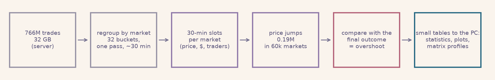

Most of the report covers **event markets**: elections, sports, economy, culture, and so on.
That is about 430,000 markets. The recurring crypto "up or down" markets ("Will bitcoin be up in
the next 15 minutes?") behave differently and are covered in [F8](#f8-crypto-up-or-down-markets-the-same-pattern-over-within-seconds).

### Idea 1: a price jump

Here is a real market: *"Will Apple launch another iPhone on February 19?"* (2025), a small
market with 599 trades. On 13 February Tim Cook announced "the newest member of the family"
for 19 February, and Polymarket opened one market per possible product. A separate market
covered an "iPhone SE", the name everyone expected, so this one was in effect a bet on a
different name. It traded near 10% for two days. On Saturday 15 February one trader pushed
it to 70% with no news we could find, and other traders sold it back to 25% by Monday. On
16-17 February reports spread (Bloomberg's Mark Gurman first) that the phone would get a new
name; on the afternoon of the 17th (US time) several traders lifted the price from 28% to
about 70%, and it held. On 19 February Apple announced the **iPhone 16e**: the market
resolved **YES** (and the iPhone SE market NO).

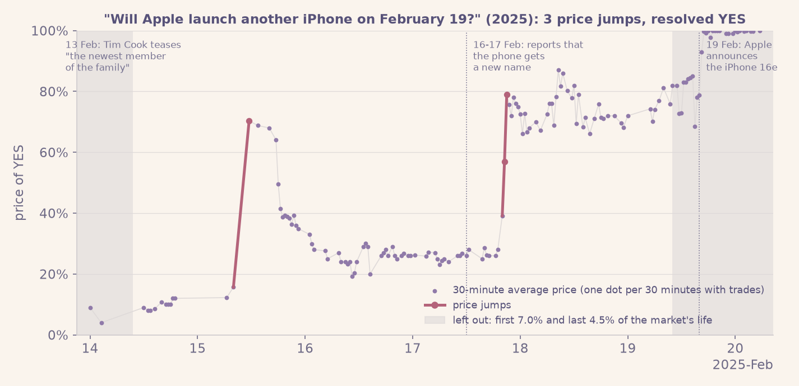

The trades are grouped into 15-minute slots, and each slot gets its average price: each dot
is one slot with trades. A **price jump** (red) is a slot whose price is at least **10
percentage points** away from the previous slot with trades.

Two stretches of each market's life are left out (grey). The life runs from the first trade
to the moment the price leaves 5-95% for good (or to the last trade, if it never does):
- **the first 10%**, while the price is still being found;
- **the last 10%**, the run-up to 0% or 100% that every market makes, which would only
  measure the obvious.

Because both scale with the market, a three-hour game loses about 20 minutes at each end and
a year-long election market about five weeks. In this market that leaves six jumps: the lone
push on the 15th and its reversal, and the rise on the 17th and the swings after it. The
announcement itself falls in the last 10%.

**How common are price jumps?** Half of political markets have some; most sports and esports
markets, which are short and many, have none:

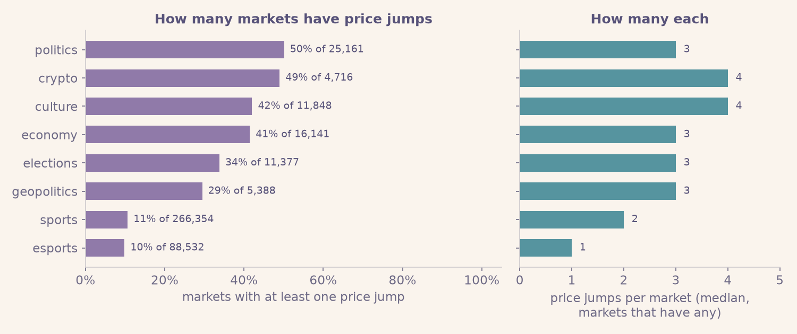

Two facts about these jumps matter for everything that follows.

**They involve little money.** The median price jump has $11 traded in its 15 minutes, and
80% have less than $100. A price can jump on a few dollars because, in most markets, few
orders sit near the current price. A small order runs through them and reaches prices far
away.

**Most are made by a single trader "taking liquidity".** Some traders post an order and wait
("I'll sell at 30%"): they are the *makers*. Others accept a posted order immediately: they
are the *takers*, and only takers move the price. So for each price jump we count the
different wallets that took liquidity in its 15 minutes. In 70% of price jumps there is just
one, and that trader spent a median of $5.

### Idea 2: overshoot

Zoom in on Saturday 15 February. At 07:51, in one transaction, a single trader bought $477 of
YES in five fills: four at 15-16% and a last one at 77%, which left the price there. The next
trades were at about 70%, so the 15-minute average jumped from 16% to 70%. No news came out;
by the evening other traders had sold it back to 40%, and by Monday morning it was at 26%.
Most of the jump was given back. (The market still resolved YES, four days later, for a
reason this trader could not have known on Saturday.)

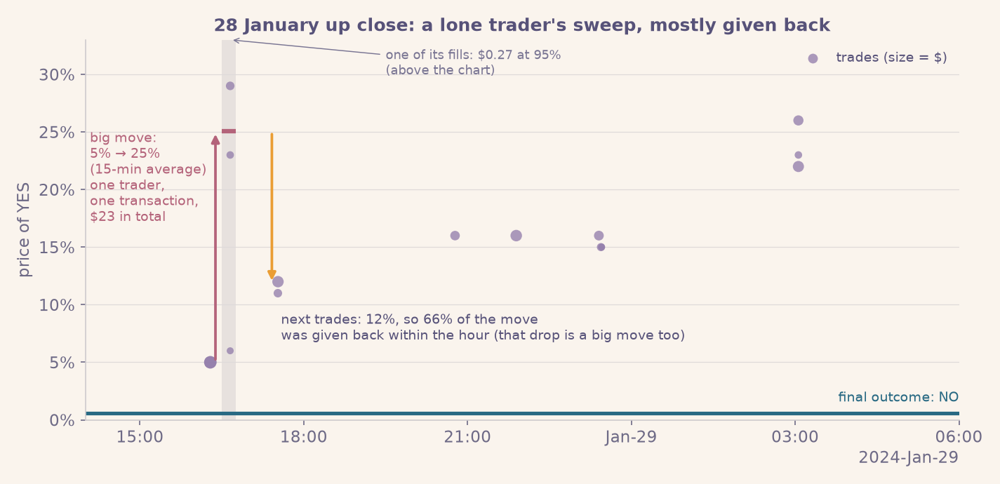

The part of a jump that turns out to be unjustified is the **overshoot**. One market can't
measure it, but thousands can:
1. Take all jumps that ended at, say, 60%.
2. If those prices were right, YES should win 60% of the time.
3. If YES wins only 53% of the time, the prices were 7 points too high.
4. Against a 20-point jump (40% → 60%), that is an overshoot of 7 / 20 = **35% of the jump**.

Prices are slightly off even at quiet moments (YES tends to be a little overpriced), so
that usual error is measured at random moments and subtracted first. An overshoot of 0%
means the jumps were exactly right; a negative one means the price didn't go far enough.

```python
# outcome = 1 if YES won, else 0;  p_close = price after the jump, p_pre = before it
baseline  = usual_error_at(p_close)                  # mean (outcome - price) at random moments
overshoot = -((outcome - p_close) - baseline) * sign(jump)
overshoot_share = overshoot.sum() / abs(p_close - p_pre).sum()   # over many jumps
```

Uncertainty ranges come from resampling whole markets.

**A note on averaging.** Each 15-minute price is volume-weighted: a trade counts in
proportion to its dollars. Weighting only acts *within* a slot, so a slot traded by one
wallet simply gets that wallet's average fill. Re-measuring with plain averages, every trade
counting equally, gives the same conclusions, with crowd overshoots a few points lower.

---

## 3. The findings

### F1. Price jumps overshoot by over a third

Across 260,215 price jumps in 66,193 markets with a clear outcome, the price right after a
jump is on average **too extreme by 36% of the jump** (range 35.6-36.6%).

The plot shows it without any formula. For jumps that ended at a given price (x-axis), it
shows how often YES actually won (y-axis):
- after an **up** jump to about 60%, YES won only 47% of the time;
- after a **down** jump to about 60%, YES won 61% of the time;
- at random moments, a 60% price won 57% of the time.

After a jump, the price sits too far in the direction of the jump.

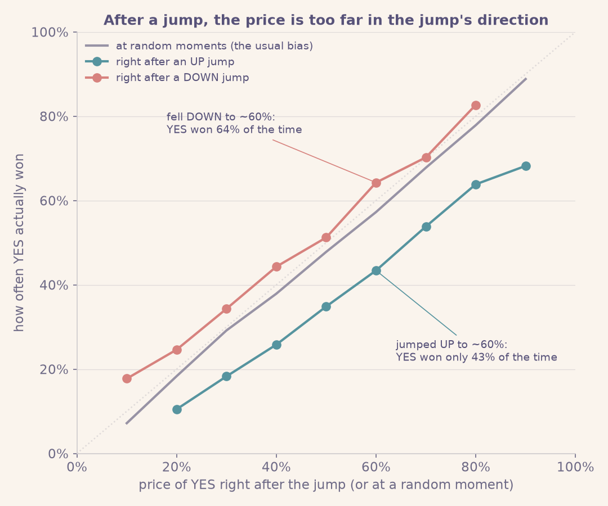

It is between 31% and 39% in every category and every year, and at any distance from the
market's end. It is highest for jumps starting below 20% (46%):

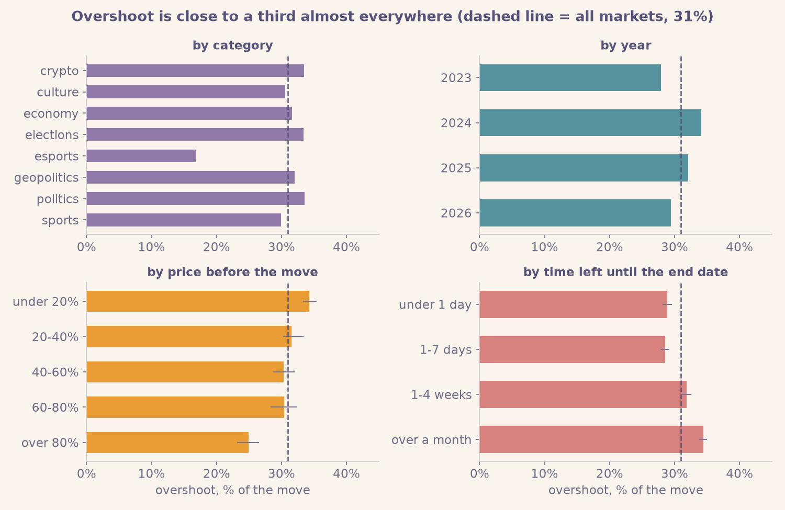

The size varies by topic. Across 109 tags it ranges from 16% to 48%. Markets on stock prices
(Amazon, Meta, Netflix, Tesla) and weekly or daily price markets are at the low end; UFC,
oil, earnings, world elections and Iran at the high end.

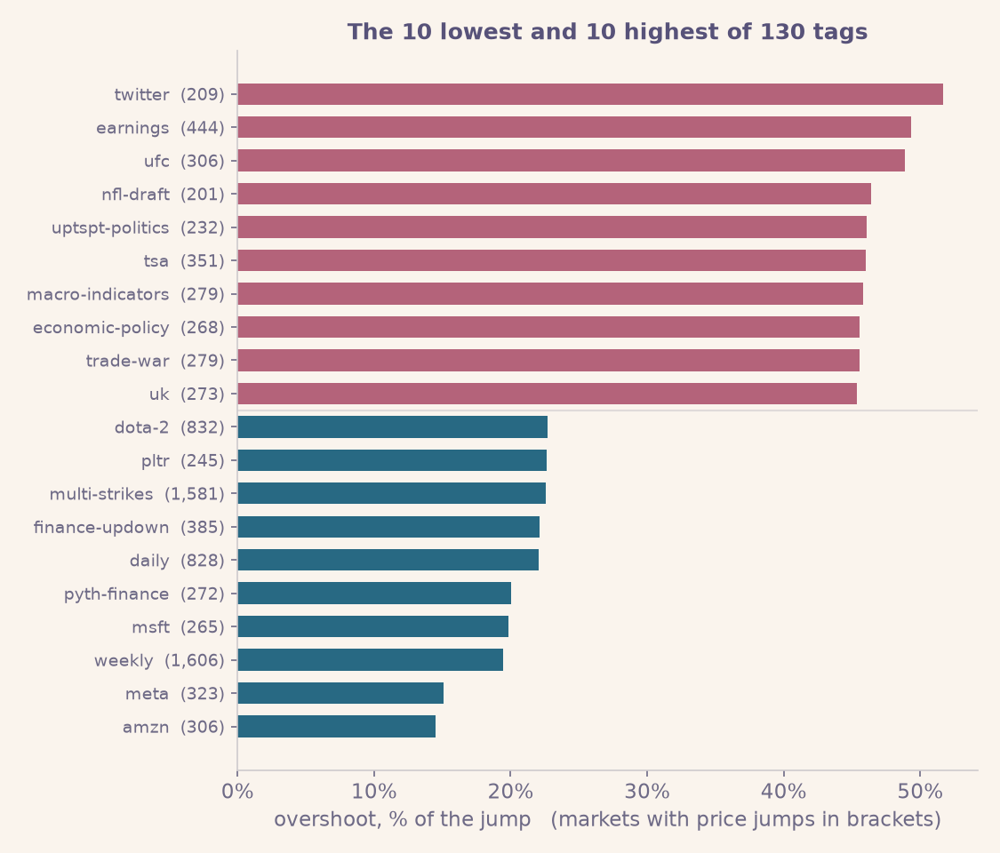

---

### F2. Jumps made by many traders stick; jumps made by one trader don't

The best predictor of overshoot is **how many different traders took liquidity in the
jump's 15 minutes**.

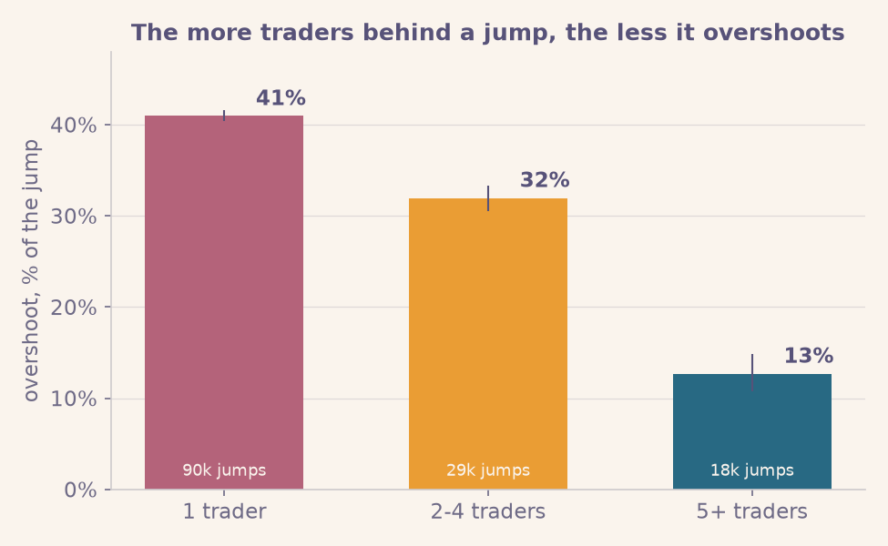

Two real jumps show the contrast:
- **Left:** on 19 January 2025, one trader paid $2,000 in 11 fills and pushed
  "Will Carlos Alcaraz win the Australian Open?" from 27% to 59%. Ten minutes later the price
  was back at 33%, and the market resolved NO.
- **Right:** during a BMW Open match on 14 April 2026, 112 traders put $25,600 into "Marozsan
  vs Tsitsipas" and moved a Marozsan win from 22% to 42%. The move held for hours, and
  Marozsan won.

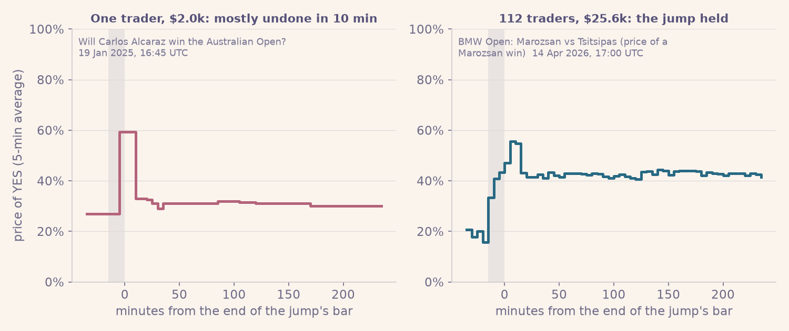

The pattern is robust:
- **At the same money.** In every money band, one trader's jumps overshoot the most. Above
  $500 the gap is widest: 46% for one trader against 23% for four or more.

  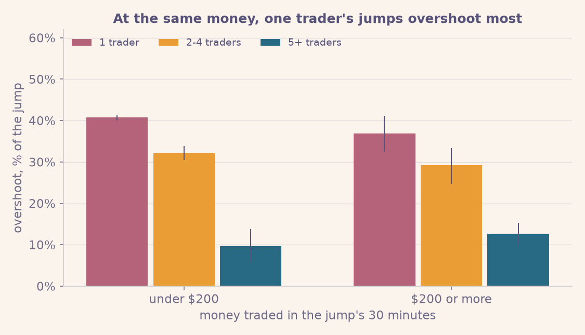

- **For every definition of a price jump:** 5-, 15- or 60-minute slots, and jumps of at
  least 5, 10 or 15 points.

  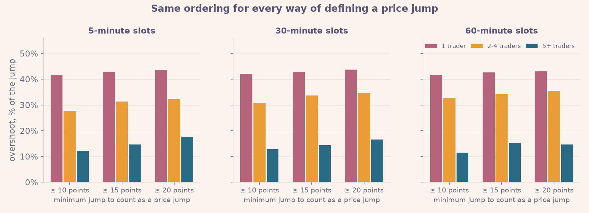

- **With everything else held fixed.** A regression holds category, question type, money,
  price level, time to the end, market lifetime, year and direction fixed at once. Crowd
  jumps still overshoot 17 points less than single-trader jumps, against 18 points raw.

  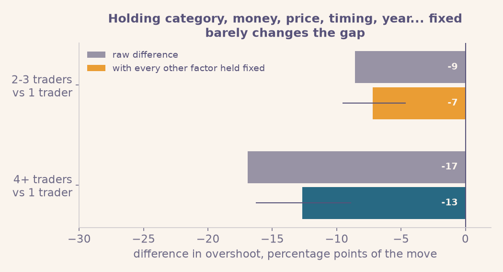

- **It's not a handful of wallets.** The 182,000 single-trader jumps come from 74,000
  wallets. A wallet's overshoot in the first half of its history barely predicts the second
  half.

  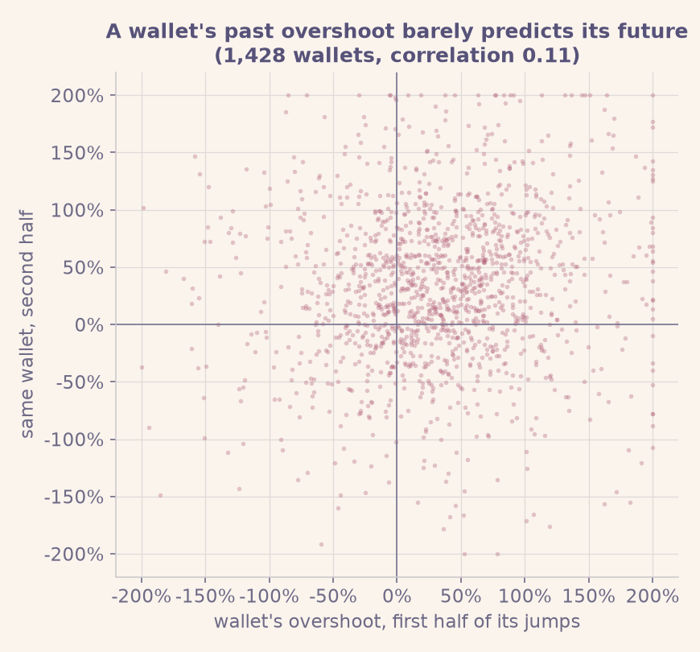

**What it means.** Agreement between several independent traders is a much better sign of
information than the size of a jump.

---

### F3. A lone trader's push is undone within minutes

Following the same jumps over time (those with prices a day later):
- **One trader:** the overshoot falls from 42% to **9% at the very next trades**.
- **Four or more traders:** it starts lower (34%) but lingers. It is still 28% at the next
  trades and 20% after an hour, and almost gone (5%) after a day.

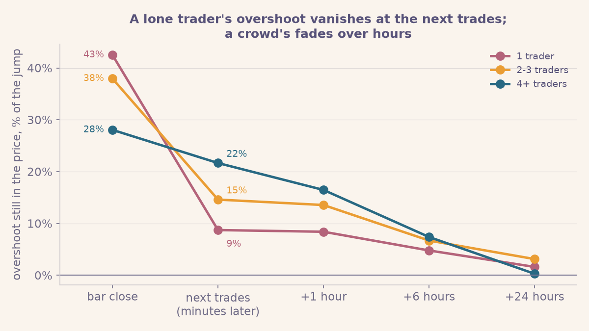

"Next trades" means the first five trades after the 15 minutes. They come a median of 1½
minutes after crowd jumps and 16 minutes after single-trader jumps, which happen in quieter
markets.

**What it means.** A lone trader's push is mostly temporary *price impact*: one order walks
the price through a thin book, and the next traders bring it back. A crowd's smaller
overshoot is a slower over-reaction.

---

### F4. In a race, a crowd's jump that the other candidates offset is right at once

Many questions on Polymarket are races: who wins an election, which team wins a league.
Each candidate is its own market, and exactly one of them will win. Most of these races are
**neg-risk** events (a flag in the data): a NO share in one candidate can be converted into
YES shares of all the others. This links the candidates' prices, so that their YES prices add
up to about 100%, and it gives liquidity even to the long shots.

So when one candidate jumps, the others should fall by about as much in total. For each of
the 36,909 price jumps in neg-risk events, we checked what the other candidates did in the
same 15 minutes. They either **offset** the jump (moved the other way by at least 75% of it),
**partly** offset it (25-75%), did **not** offset it, or did not trade at all.

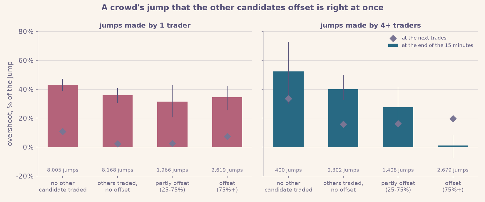

- A **crowd's jump** (4+ traders) that the others offset is right at once: +1% at the end of
  the 15 minutes (range −8% to +9%). Without the offset it overshoots by 40%, and by 52% if
  no other candidate traded.
- For a **lone trader's** jump the offset makes no difference: 34-43% either way.
- By the **next trades** the difference is gone: crowd jumps are 16-20% too far, offset or not.

**What it means.** In a race, a crowd jump that the rest of the field confirms by repricing
is right at once. A jump the rest of the field ignores goes too far until the next trades
correct it. Outside neg-risk events (73,000 jumps), offset jumps are no better (35% against
28% overshoot), but there the markets of an event need not exclude each other, so an "offset"
means little.

---

### F5. Betting against jumps: a loss after lone pushes, a small edge after crowd jumps

If jumps overshoot, betting against them should pay. Each test bet buys the opposite side
right after the jump, at the price a bettor would actually have paid, and holds it to the
end. Returns are measured per $1 staked, net of the usual pricing error. Bets are placed
only when the jump started between 5% and 95%, because below that the opposite side costs a
few cents and a single win pays 20 times the stake.

Even so, a few very large wins dominate the plain averages. With the most extreme 1% at each
end trimmed:

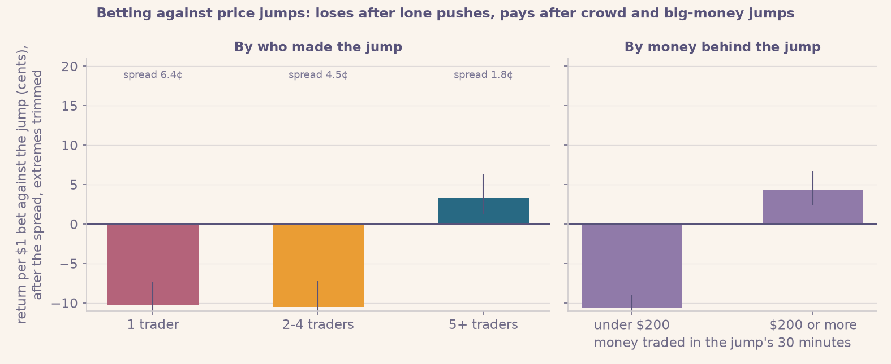

- **After single-trader jumps, betting against them loses** about 8 cents per $1 (range 7-10).
  The fast snap-back happens, but the bid-ask spread (a median 5.7 cents) eats it.
- **After crowd jumps (4+ traders), it gains** about 8 cents per $1 (range 6-10), where the
  spread is only 1.8 cents.
- **After jumps with over $1,000 behind them, it gains** about 15 cents per $1 (range 12-19).

**What it means.** The large overshoot of lone pushes is gone before anyone can trade on it.
What a bettor can capture is the smaller overshoot of crowd and big-money jumps, which the
next trades leave in place (F3). Fees and queue position are not modelled, so this is an
upper bound.

---

### F6. Lone pushes happen in thin markets

Some markets see single-trader jumps all the time, others never. For each of 99,892
markets with at least 20 active slots, standard market-structure measures were computed:
- how concentrated trading is among wallets (Gini, Herfindahl, the biggest wallet's share);
- how far $1,000 of net buying moves the price (Kyle's lambda);
- the bid-ask spread (Roll's estimator, and the buy-sell price gap within a minute);
- how balanced buying and selling are.

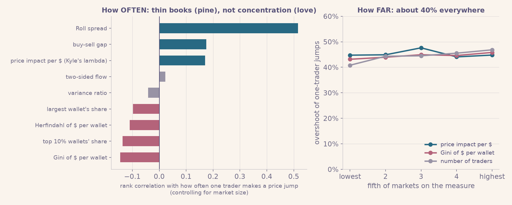

- **How often one trader can push the price depends on how thin the book is.** With market
  size held fixed, it correlates with the spread (+0.55) and with the price impact per
  dollar (+0.23).
- **Concentration among a few wallets doesn't explain it** (Gini −0.16: if anything, the
  opposite).
- **This holds in every category.**
- **How far the push goes doesn't depend on the market:** one-trader jumps overshoot 40-47%
  in every fifth of the markets, on every measure (right panel).

Across 197 tags the link is strong (+0.66). Mention markets, TSA, stock and equity markets
are at the top; football leagues and world elections at the bottom.

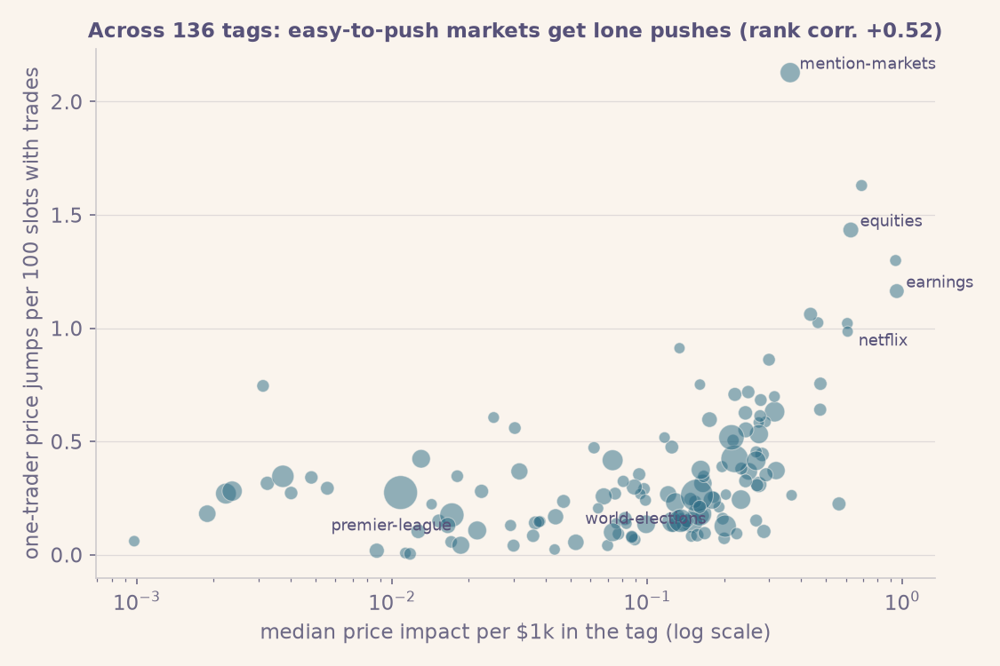

---

### F7. Sports and esports: the same pattern

Sports and esports make up most markets but have the fewest jumps per market: 90,881 price
jumps in 35,358 markets with a clear outcome. Because the left-out stretches scale with each
market's life, a game market keeps its game. The data has no kickoff times, so jumps before
and during a game are not told apart.

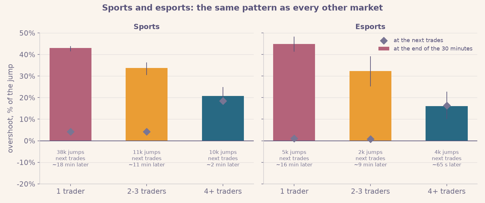

- **Lone pushes overshoot as everywhere else** (43% in sports, 41% in esports), and the next
  trades undo them.
- **Crowd jumps overshoot less** (24% and 19%), but about 20% is still there at the next
  trades, which come within a minute or two.

By sport, the overshoot ranges from 25% (Dota) to 46% (combat sports):

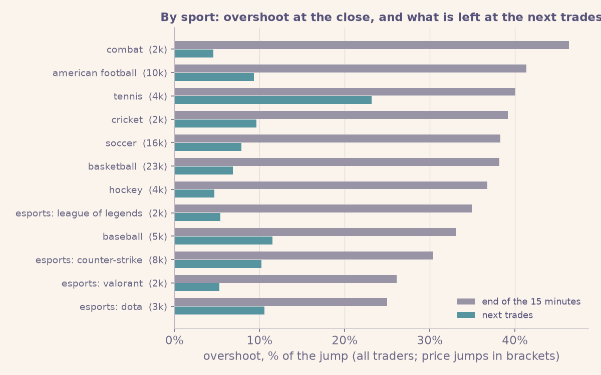

**What it means.** Game markets behave like every other market.

---

### F8. Crypto "up or down" markets: the same pattern, over within seconds

These recurring markets (bitcoin, ether, solana and xrp, over 5 minutes, 15 minutes or 1
hour) hold 59% of all trades. Measured on 1-minute slots: 366,115 price jumps in 117,868
markets. Only the stretch after the price settles is left out here: the 10% rule would remove
70% of these markets' jumps.

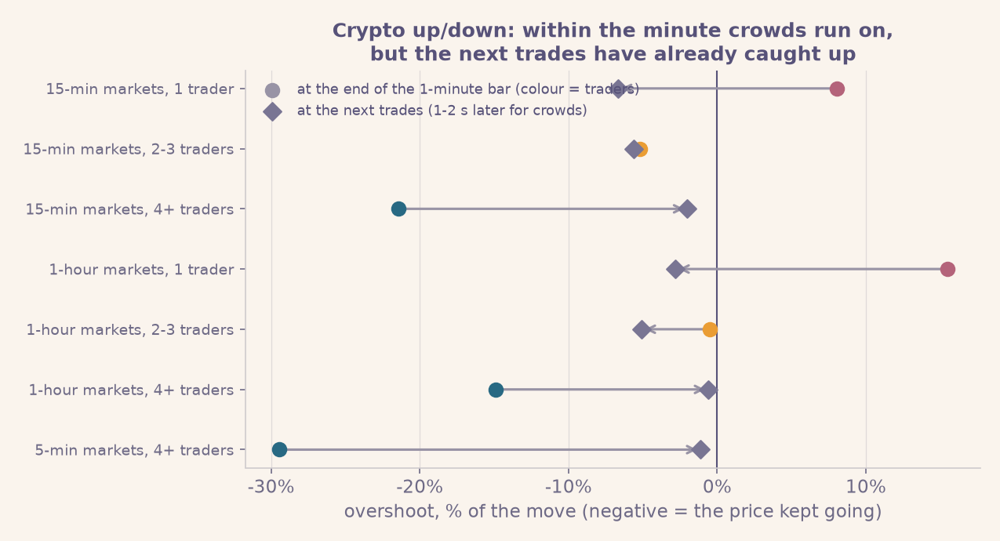

At the end of the minute the familiar pattern appears: lone pushes go too far (+9% to +13%)
and crowd jumps keep going (−16% to −30%). By the next trade, one or two seconds later,
every group is within about ±5%: nothing is left to exploit.

A related market decides the direction. A crowd jump in bitcoin's market keeps going when
ether's market moved the same way in that minute (−31%), and reverses when it moved the other
way (+19%).

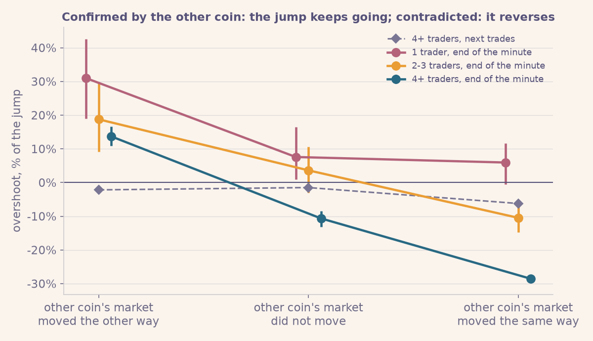

---

### F9. Searching for recurring patterns

We also looked for recurring shapes with *matrix profiles*, a standard pattern-search tool
for time series. Price paths after price jumps show **no recurring shape beyond chance**: 5.1%
of real paths have a close match elsewhere, against 5.0% of shuffled ones. In the chain of
bitcoin's 15-minute markets, the unusual stretches are "whipsaw" markets where the price
crosses 50% about six times. Comparing the coins' chains shows that their markets move
together, with bitcoin and ether about 30 seconds ahead of solana and xrp. All of this is
real but has plain explanations, and none of it is tradable.

---

### F10. News or noise? A tentative look

A last, less conclusive check: can one tell a jump that carries news (many traders, a lasting
effect) from one trader's noise?

After the fact, partly. What the next trades within the hour do to a jump says more than who
made it. Jumps the next trades took further were about right at the close; jumps they
reversed were wholly unjustified. This holds for every trader group. A jump with 4+ traders
that the next trades kept had an overshoot of only 5% (range 2-7%). A one-trader jump that
the next trades mostly gave back had 75%.

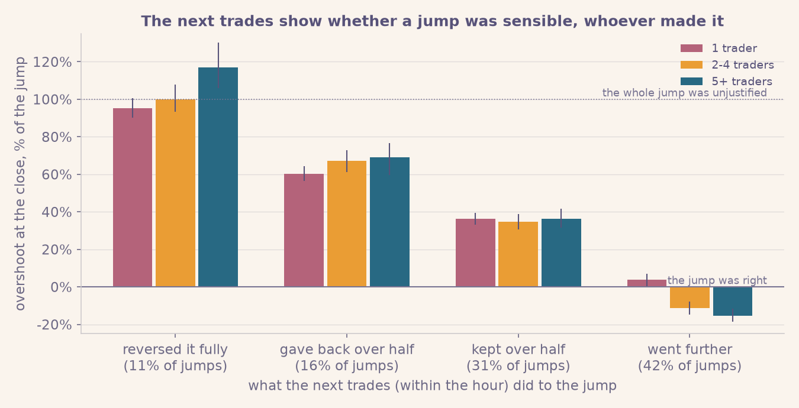

At the moment of the jump, though, the signs are weak. The number of traders helps most (23%
overshoot with 4+ traders, 40% without). A new trade within five minutes helps a little (29%
vs 41%), and so does $1,000 or more (33% vs 39%). Another market of the same event jumping
at the same time does not help (37% vs 39%). And 59% of one-trader jumps have no trade at all
in the following hour, so for most lone pushes the after-the-fact test cannot be applied. This
is a description, not a tool.

---

## 4. What did not work

- **Recurring price shapes across markets.** Real matches were no more common than chance.
- **"Price moved without money" anomalies.** Mostly bid-ask bounce: trades alternating
  between the buy and the sell side.
- **"More trades means more reversal".** An artefact of using the last trade price: a sweep's
  last fill is its most extreme price. Fixed by using 15-minute averages.
- **"Bet against crypto YES spikes".** It was just crypto YES being about 8 points overpriced
  in general. Fixed by measuring the usual error per category.
- **Concentration (Gini) as the cause of lone pushes.** With size and price impact held
  fixed, it adds nothing.
- **Bitcoin anomalies clustering at US data-release hours.** This did not hold up.
- **Splitting game markets into before and during the game.** The data has no kickoff
  times, and the end date is not a reliable stand-in (esports matches often settle hours
  before it), so no such split is made.

---

## 5. Limitations

- **"Next trades" is an average of real trades, not a guaranteed price.** F5 uses
  side-specific prices, but fees and queue position are not modelled.
- **The usual-error correction is estimated from the data**, per category or question type.
  Other ways of estimating it move the levels by 1-3 points without changing any comparison.
- **Most jumps are small in money.** The findings describe how prices behave, not a large
  pool of money.
- **The last 10% of a long market is left out.** For an election market that is its final
  weeks, when much of the news arrives.
- **Approximate labels.** Categories and question types come from text rules.
- **No external data.** There are no news timestamps or live scores, so "confirmation" always
  means other Polymarket prices.

---

## 6. Reference: methods and parameters

### 6.1 Data and price jumps

| Step | Choice |
|---|---|
| Markets | all event markets with trades; recurring crypto up/down markets analysed separately (F8) |
| YES price per trade | `price` if the traded token is token 1, else `1 - price` |
| Slots | **15 min** (main); 5 and 60 min as checks; **1 min** for crypto up/down |
| Slot price | volume-weighted average (VWAP); checked against the plain average of trades |
| Price scale | log-odds `log(p / (1 - p))`, p clipped to [0.01, 0.99] |
| **Price jump** | a slot whose price is ≥ **10 points** from the previous slot with trades (checks: 5 and 15) |
| Window | a market's life runs from its first slot to the last slot inside [5%, 95%] when it ends outside that band (else to its last slot); the first and last **10%** of it are left out. F8: only the slots after that last slot are left out |
| Outcome | first outcome price > 0.99 → YES, < 0.01 → NO, otherwise the market is left out |
| Categories, question types | first match of a text rule on the tags / question |

### 6.2 Overshoot and statistics

| Item | Choice |
|---|---|
| Usual error (baseline) | mean (outcome - price) in 20 price bins of 5 points, at random moments (a 5% sample of slots); pooled for F1, per category for F2-F3 and F7, per question type for F4-F5, per coin and length for F8 |
| Overshoot | `-((outcome - p) - baseline(p)) × sign(jump)` at any later price p; shared as Σ overshoot / Σ \|jump\| |
| Next trades | the first **5 trades** after the slot, within **1 h** (5 min for crypto) |
| Trader groups | distinct taker wallets in the jump's slot: **1 / 2-3 / 4+** |
| Uncertainty | resampling whole markets, 200-300 times |
| All factors at once (F2) | weighted least squares, weight \|jump\|; dummies for traders, question type, category, money, price band, time to end, lifetime, year, direction |
| Wallets (F2) | wallets with ≥ 10 single-trader jumps; overshoot in the first vs second half of their history |
| Betting against jumps (F5) | entry = first 5 trades on the bettor's side within 1 h; return per $ = sign × (entry - outcome) / stake; jumps starting between 5% and 95%; returns trimmed at the 1st and 99th percentile |
| Market structure (F6) | markets with ≥ 20 active slots; Kyle's lambda = slope of the slot's price change on net buying (consecutive slots ≤ 2 h apart, ≥ 20 slots); Roll spread; Spearman correlations controlling for traders, money and slots |
| Other candidates (F4) | neg-risk events (`neg_risk` = 1); offset = −(sum of the other candidates' price changes in the slot) / the jump; groups: none traded, < 25%, 25-75%, ≥ 75% |
| Crypto (F8) | other coin = ether for bitcoin, bitcoin for the others; "moved" = ≥ 0.1 log-odds in the same minute |

### 6.3 Pattern search (F9)

| Search | Series | Window | Distance | Chance comparison |
|---|---|---|---|---|
| After price jumps | 55 five-minute prices per jump (−35 min to +4 h), 20,000 jumps with ≥ 6 h of the window left | 55 | z-normalised; matches must be in another event; paths need ≥ 8 price changes | post-jump steps shuffled |
| Bitcoin chain | bitcoin 15-min markets back to back, 30 points each (673,620 points) | 30 | z-normalised, `stumpy.stump` | profile vs 200 shuffles |
| Coin pairs | the 4 coins' 15-min chains, AB-joins | 30 | `stumpy.stump(T_A, 30, T_B)` | other coin shuffled in time |

### 6.4 Computing and plots

- **Server:** each extraction step runs on 2 threads within 8 GB of memory. Regrouping the
  766 million trades takes one pass of about 30 minutes.
- **Plots:** Python with numpy, pandas, scipy, stumpy and matplotlib, in the Rose Pine Dawn
  theme. The trader groups have fixed colours: 1 trader = rose-red, 2-3 = gold, 4+ = pine blue.

---

## 7. Glossary

| Term | Meaning |
|---|---|
| **YES price** | Price of the share that pays $1 if the event happens; read as a probability |
| **Log-odds** | `log(p / (1 - p))`; stretches the scale near 0% and 100% |
| **Slot** | A 15-minute window in which trades are grouped |
| **Price jump** | A slot whose price is ≥ 10 points from the previous slot with trades |
| **Life of a market** | From its first trade to the moment its price leaves 5-95% for good (or its last trade); the first and last 10% are left out |
| **Maker / taker** | The maker posted an order and waited; the taker accepted it, moving the price ("taking liquidity") |
| **Overshoot** | The part of a jump that the final outcome did not justify, beyond the usual error, as a % of the jump |
| **Next trades** | The first five trades after a jump |
| **Neg-risk event** | A Polymarket race whose candidates exclude each other; a NO share in one converts into YES shares of all the others, which links their prices and gives the long shots liquidity |
| **Spread** | The gap between the price to buy and the price to sell |
| **Kyle's lambda** | How far $1,000 of net buying moves the price |
| **Gini / Herfindahl** | Measures of how concentrated trading is among wallets |
| **Matrix profile** | For every window of a series, the distance to its most similar other window |

---

## 8. Where the code is

| Step | Scripts |
|---|---|
| Server extraction | `remote/s1_bucket.py` (regroup trades), `s2_events.py` / `s3_events.py` (slots, window and jumps), `s4_paths.py` (price paths, crypto jumps), `s6_micro.py` (market structure), `s7_events.py` (plain averages), `s8_wallets.py` (wallets and other candidates), `p7_extract.py` (example market) |
| F1-F3 | `explore/r02_persistence.py`, `r03_robustness.py`, `r04_types.py`, `r07_basis.py` |
| F2 regression | `explore/r05_event_markets.py` |
| F4 | `explore/r08_pairs.py`, `r07_siblings.py` |
| F5, F6 | `explore/r06_fade.py`, `r08_fade_robust.py`, `r06_concentration.py` |
| F7, F8 | `explore/r07_sports.py`, `r05_updown.py` |
| F9 | `explore/r04_motifs.py`, `r04_btc_chain.py`, `r05_crypto_mp.py` |
| F10 | `explore/r10_information.py` |
| Definition checks | `remote/s9_window.py`, `s9_variants.py`; `explore/r09_threshold.py`, `r09_window.py`, `r09_sweep.py`, `r09_crypto.py`, `r08_filters.py` |
| This report | `explore/report_stats.py`, `report_figures.py`, `report_style.py` |

**Related work:** Tsang & Yang, "Political Shocks and Price Discovery in Prediction Markets"
and "The Anatomy of Polymarket" (arXiv 2603.03152, 2603.03136); Akey, Vincent, Harvie &
Martineau, "Who Wins and Who Loses in Prediction Markets? Evidence from Polymarket" (CEPR DP
21615, 2026); Roll (1984).
