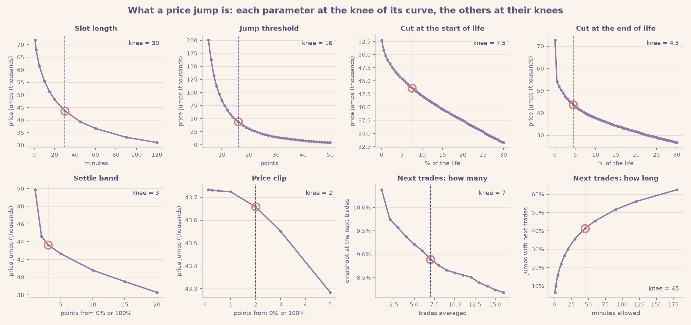
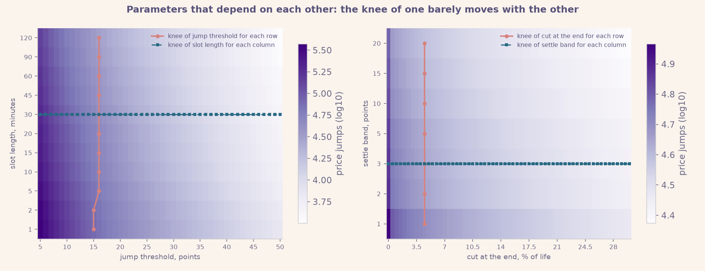
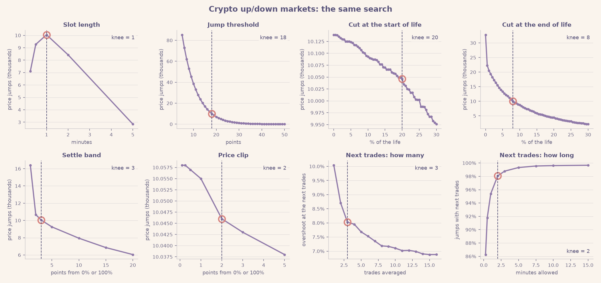
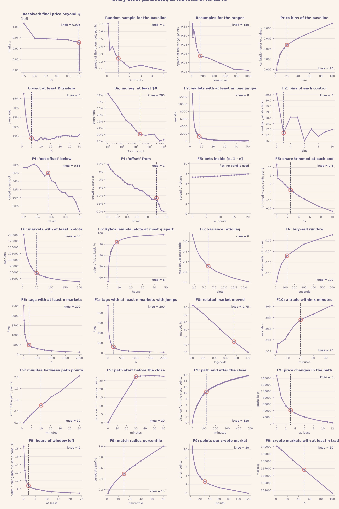
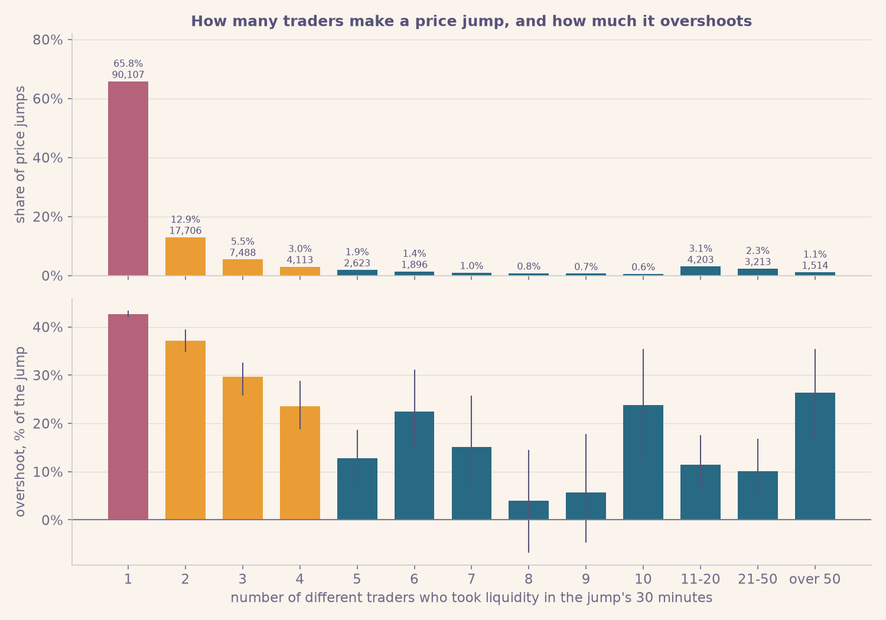
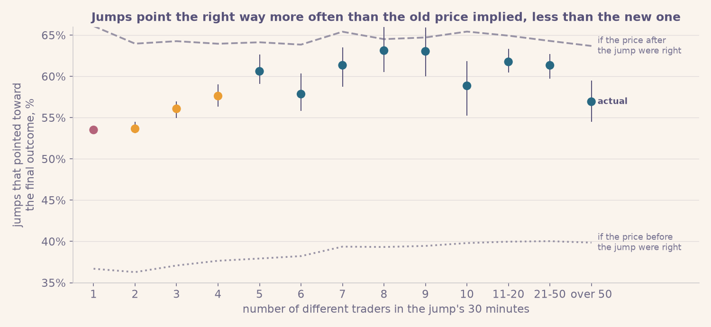
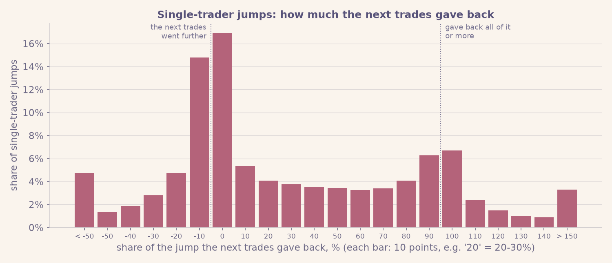

# Jumping to Conclusions: Polymarket Price Jumps Analysis

*An exploratory analysis of 766 million Polymarket trades, November 2022 to May 2026*

Code and plots: [github.com/CrabGuy/PolymarketPriceJumpsAnalysis](https://github.com/CrabGuy/PolymarketPriceJumpsAnalysis)

---

## Contents

1. [In short](#1-in-short)
2. [The data and two ideas](#2-the-data-and-two-ideas)
   - [How the parameters were chosen: the elbow method](#how-the-parameters-were-chosen-the-elbow-method)
3. [The findings](#3-the-findings)
   - [F1. Price jumps overshoot by over a third](#f1-price-jumps-overshoot-by-over-a-third)
   - [F2. Jumps made by many traders stick; jumps made by one trader don't](#f2-jumps-made-by-many-traders-stick-jumps-made-by-one-trader-dont)
   - [F3. A lone trader's push is undone within minutes](#f3-a-lone-traders-push-is-undone-within-minutes)
   - [F4. In a race, a crowd's jump that the other candidates offset is right at once](#f4-in-a-race-a-crowds-jump-that-the-other-candidates-offset-is-right-at-once)
   - [F5. Betting against jumps: a loss after lone pushes, a small edge after crowd jumps](#f5-betting-against-jumps-a-loss-after-lone-pushes-a-small-edge-after-crowd-jumps)
   - [F6. Lone pushes happen in thin markets](#f6-lone-pushes-happen-in-thin-markets)
   - [F7. Sports and esports: the same pattern](#f7-sports-and-esports-the-same-pattern)
   - [F8. Crypto "up or down" markets: the same pattern, over within seconds](#f8-crypto-up-or-down-markets-the-same-pattern-over-within-seconds)
   - [F9. Searching for recurring patterns](#f9-searching-for-recurring-patterns)
   - [F10. News or noise? A tentative look](#f10-news-or-noise-a-tentative-look)
4. [What did not work](#4-what-did-not-work)
5. [Limitations](#5-limitations)
6. [Reference: formulas, methods and parameters](#6-reference-formulas-methods-and-parameters)
7. [Glossary](#7-glossary)
8. [Where the code is](#8-where-the-code-is)

---

## 1. In short

On Polymarket, people bet on events by buying shares that pay $1 if the event happens, so a
share's price is the market's probability for the event. We looked at every sharp price
jump in 766 million trades and asked one question: **judging by how the market finally
resolved, how much of the jump was justified?**

**Just under two thirds.** The rest, a little over a third, is an **overshoot**: noise that
the market later takes back. This holds in every year and every category.

What tells real jumps from noise is **how many different traders made them**:
- A jump made by one trader goes about 40% too far, and the next trades, minutes later,
  undo most of it.
- A jump made by a crowd (five traders or more) goes about a seventh too far, and that
  part lingers for hours.
- Lone pushes are common where the order book is thin, so that a few dollars can move the
  price.

Once the bid-ask spread is paid, betting against lone pushes loses money. Betting against
crowd jumps, and jumps with $200 or more behind them, leaves a small edge before fees.

---

## 2. The data and two ideas

### The data

We used every Polymarket trade from November 2022 to May 2026: 766 million trades in about
one million markets, each with a time, a price, a dollar amount and the two wallets
involved. The heavy work ran on a server; small summary tables were analysed on a PC.

Most of the report covers **event markets**: elections, sports, economy, culture, and so on.
That is about 430,000 markets. The recurring crypto "up or down" markets ("Will bitcoin be up in
the next 15 minutes?") behave differently and are covered in [F8](#f8-crypto-up-or-down-markets-the-same-pattern-over-within-seconds).

### Idea 1: a price jump

Here is a real market: *"Will Apple launch another iPhone on February 19?"* (2025), a small
market with 599 trades. On 13 February Tim Cook announced "the newest member of the family"
for 19 February, and Polymarket opened one market per possible product. A separate market
covered an "iPhone SE", the name everyone expected, so this one was in effect a bet on a
different name. It traded near 10% for two days. On Saturday 15 February one trader pushed
it to 70% with no news we could find, and other traders sold it back to 25% by Monday. On
16-17 February reports spread (Bloomberg's Mark Gurman first) that the phone would get a new
name; on the afternoon of the 17th (US time) several traders lifted the price from 28% to
about 70%, and it held. On 19 February Apple announced the **iPhone 16e**: the market
resolved **YES** (and the iPhone SE market NO).

The trades are grouped into 30-minute slots, and each slot gets its average price: each dot
is one slot with trades. A **price jump** (red) is a slot whose price is at least **16
percentage points** away from the previous slot with trades.

Two stretches of each market's life are left out (grey). The life runs from the first trade
to the moment the price leaves 3-97% for good (or to the last trade, if it never does):
- **the first 7.5%**, while the price is still being found;
- **the last 4.5%**, the run-up to 0% or 100% that every market makes, which would only
  measure the obvious.

Because both scale with the market, a three-hour game loses about 13 minutes at the start
and 8 at the end, and a year-long election market about four weeks and two weeks. In this
market that leaves three jumps: the lone push on the 15th, and the rise on the 17th in two
steps. The announcement itself falls in the last 4.5%. Every number in this definition
(30 minutes, 16 points, 7.5%, 4.5%, 3%) was set by the elbow method, [below](#how-the-parameters-were-chosen-the-elbow-method).

**How common are price jumps?** 38% of political markets have some; most sports and esports
markets, which are short and many, have none:

Two facts about these jumps matter for everything that follows.

**They involve little money.** The median price jump has $10 traded in its 30 minutes, and
78% have less than $100. A price can jump on a few dollars because, in most markets, few
orders sit near the current price. A small order runs through them and reaches prices far
away.

**Most are made by a single trader "taking liquidity".** Some traders post an order and wait
("I'll sell at 30%"): they are the *makers*. Others accept a posted order immediately: they
are the *takers*, and only takers move the price. So for each price jump we count the
different wallets that took liquidity in its 30 minutes. In 66% of price jumps there is just
one, and that trader spent a median of $4.

### Idea 2: overshoot

Zoom in on Saturday 15 February. At 07:51, in one transaction, a single trader bought $477 of
YES in five fills: four at 15-16% and a last one at 77%, which left the price there. The next
trades were at about 70%, so the 30-minute average jumped from 16% to 70%. No news came out;
by the evening other traders had sold it back to 40%, and by Monday morning it was at 26%.
Most of the jump was given back. (The market still resolved YES, four days later, for a
reason this trader could not have known on Saturday.)

The part of a jump that turns out to be unjustified is the **overshoot**. One market can't
measure it, but thousands can:
1. Take all jumps that ended at, say, 60%.
2. If those prices were right, YES should win 60% of the time.
3. If YES wins only 53% of the time, the prices were 7 points too high.
4. Against a 20-point jump (40% → 60%), that is an overshoot of 7 / 20 = **35% of the jump**.

Prices are slightly off even at quiet moments (YES tends to be a little overpriced), so
that usual error is measured at random moments and subtracted first. An overshoot of 0%
means the jumps were exactly right; a negative one means the price didn't go far enough.

In formulas, for a jump $j$ from price $p_{j^-}$ to $p_j$, with outcome $O_j$ (1 if YES won, 0 if
NO won), direction $d_j$ (+1 up, −1 down) and $b(p)$ the usual error at price $p$:

$$o_j = -\big[(O_j - p_j) - b(p_j)\big] \cdot d_j, \qquad \text{overshoot} = \frac{\sum_j o_j}{\sum_j |p_j - p_{j^-}|}$$

Uncertainty ranges come from resampling whole markets. Every formula used in the report is
listed in [section 6.1](#61-formulas).

**A note on averaging.** Each 30-minute price is volume-weighted: a trade counts in
proportion to its dollars. Weighting only acts *within* a slot, so a slot traded by one
wallet simply gets that wallet's average fill. Re-measuring with plain averages, every trade
counting equally, gives the same conclusions, with crowd overshoots a few points lower.

### How the parameters were chosen: the elbow method

Every parameter of the analysis was set by the **elbow method**: how a price jump is defined,
which part of a market's life is used, how the next trades are taken, the trader groups, the
money threshold, the sample sizes, and the settings of each finding. Splits used only to
display a finding (price bands, years, histogram bins) are not parameters and were not tuned;
the uncertainty ranges are 95% ranges, a convention.

For each parameter, a curve is drawn over a wide range of values. It shows what the parameter
controls: how many jumps it keeps, how noisy a number is, or the result itself. Such curves
usually change fast at first and then flatten. The **knee** is where they bend; we find it
with the Kneedle rule (Satopää et al., 2011): the point farthest from the straight line that
joins the two ends of the curve, with both axes scaled to 0-1 ([formula](#61-formulas)). Three
rules apply to every curve:
- **One axis.** The knee is always found on a linear axis, never a log one (the two can
  give different knees for parameters tried over a wide range).
- **Enough jumps.** A point of a curve that is a share of jumps needs at least 1,000 jumps
  behind it; thinner points are left out.
- **Parameters that depend on each other are searched together.** Each one is set to the
  knee of its curve with all the others at their own knees, and this is repeated until no
  knee moves (a fixed point; it took three rounds).

The parameters that define a price jump, at the fixed point (each curve drawn with the other
parameters at their knees; computed on a random quarter of the markets):

They barely depend on each other. For every slot length from 1 minute to 2 hours, the
threshold's knee is 15-16 points; for every threshold, the slot length's knee is 30
minutes; and the end cut's and the settle band's knees do not move with each other:

The crypto up/down markets get their own search (F8), and every other parameter its own
curve:

All the values are listed, with the range of each curve, in [section 6.2](#62-parameters-and-how-each-was-chosen). Three things to
keep in mind:
- **Flat curves.** Where a parameter barely changes anything, its knee means little. The
  price clip changes the number of jumps by about 1% over its whole range. The price band of
  the betting test (F5) changes nothing at all, so no band is used. The pattern search (F9)
  uses every path that passes its filters, so it has no sample size.
- **Gentle bends.** Some curves are almost straight lines (the wait for a follow-up trade in
  F10, the "moved" threshold in F8, the match radius in F9). Their knee is a weak choice:
  another value close by would be as good.
- **Range.** A curve that falls off smoothly has no sharp bend, so its knee depends on the
  range of values tried. The ranges are stated in section 6.2.

---

## 3. The findings

### F1. Price jumps overshoot by over a third

Across 137,035 price jumps in 50,419 markets with a clear outcome, the price right after a
jump is on average **too extreme by 36% of the jump** (range 35.4-36.4%).

The plot shows it without any formula. For jumps that ended at a given price (x-axis), it
shows how often YES actually won (y-axis):
- after an **up** jump to about 60%, YES won only 43% of the time;
- after a **down** jump to about 60%, YES won 64% of the time;
- at random moments, a 60% price won 57% of the time.

After a jump, the price sits too far in the direction of the jump.

It is between 31% and 41% in every category and every year, and at any distance from the
market's end. It is highest for jumps starting below 20% (50%):

The size varies by topic. Across the 123 tags with at least 200 markets with jumps, it ranges
from 16% to 51%. Markets on stock prices (Amazon, Meta, Microsoft, Palantir) and weekly price
markets are at the low end; economic policy, earnings, UFC, awards and the Premier League at
the high end.

---

### F2. Jumps made by many traders stick; jumps made by one trader don't

The best predictor of overshoot is **how many different traders took liquidity in the
jump's 30 minutes**.

**Trader by trader.** 66% of price jumps are made by a single trader, 13% by two and 6% by
three; the remaining 16% are spread over four traders and more, up to several hundred. The
overshoot falls from 43% with one trader to 37% with two, 30% with three and 24% with four.
The elbow of this curve is at five traders (section 2), so the report groups traders as 1,
2-4 and 5 or more (a "crowd"). From five on, each count has under 3,000 jumps and the values
scatter (4% to 26%) with wide ranges; together they overshoot 14%.

Two real jumps show the contrast:
- **Left:** on 21 January 2025, one trader paid $244 in 5 fills and pushed "Will Aryna
  Sabalenka win the Australian Open?" from 38% to 62%. The next trades, 74 seconds later,
  were at 29%, and the market resolved NO (she lost the final).
- **Right:** on 30 January 2026, 88 traders put $27,400 into "Will Carlos Alcaraz win the
  2026 Australian Open?" and moved it from 14% to 35%. The price held and kept rising over
  the next hours, and the market resolved YES.

The pattern is robust:
- **At the same money.** Below and above $200 traded in the slot (the money threshold set by
  the elbow method), one trader's jumps overshoot the most: 41% against 11% for a crowd below
  it, 36% against 14% above it.

  

- **For other definitions of a price jump:** 5-, 30- or 60-minute slots, and jumps of at
  least 11, 16 or 21 points.

  

- **With everything else held fixed.** A regression holds category, question type, money,
  price level, time to the end, market lifetime, year and direction fixed at once. Crowd
  jumps still overshoot 18 points less than single-trader jumps, against 27 points raw.

  

- **It's not a handful of wallets.** The 90,000 single-trader jumps come from 44,000
  wallets. A wallet's overshoot in the first half of its history barely predicts the second
  half.

  

- **Do lone pushes point the right way?** A jump points the right way if it went up and YES
  won, or went down and NO won. Single-trader jumps did so 53.5% of the time. Had the price
  before the jump been right, they would have done so 36.7% of the time; had the price after
  it been right, 66.1%. So a lone push does carry information: it points the right way more
  often than the old price implied, but less often than the new price claims. It covers
  (53.5 − 36.7) / (66.1 − 36.7) = 57% of the way, which is the 43% overshoot seen from
  another angle ([why](#61-formulas)). Crowd jumps point the right way 60.7% of the time, against
  39.4% and 64.5%: 85% of the way.

  

**What it means.** Agreement between several independent traders is a much better sign of
information than the size of a jump.

---

### F3. A lone trader's push is undone within minutes

Following the same jumps over time (those with prices a day later):
- **One trader:** the overshoot falls from 43% to **9% at the very next trades**.
- **A crowd:** it starts lower (28%) but lingers. It is still 25% at the next trades and 19%
  after an hour, and almost gone (1%) after a day.

"Next trades" means the first seven trades within 45 minutes after the slot. They come a
median of 2 minutes after crowd jumps and 15 minutes after single-trader jumps, which happen in quieter
markets.

**One jump at a time.** The overshoot is an average: with an outcome that is either 0 or 1,
it cannot be read off a single jump. What can be measured jump by jump is how much of it the
next trades gave back. For the 25,252 single-trader jumps whose market traded again within
45 minutes (28% of them), the answer is spread out:
- 30% were taken further by the next trades;
- 17% were kept as they were (0-10% given back);
- 36% lost at least half, and 16% lost all of it or more;
- the median jump gave back 15%; weighted by size, 35% of the jump was given back.

So the snap-back is not every lone push losing a bit: some are reversed completely, while
others are kept or extended.

**What it means.** A lone trader's push is mostly temporary *price impact*: one order walks
the price through a thin book, and the next traders bring it back. A crowd's smaller
overshoot is a slower over-reaction.

---

### F4. In a race, a crowd's jump that the other candidates offset does not overshoot

Many questions on Polymarket are races: who wins an election, which team wins a league.
Each candidate is its own market, and exactly one of them will win. Most of these races are
**neg-risk** events (a flag in the data): a NO share in one candidate can be converted into
YES shares of all the others. This links the candidates' prices, so that their YES prices add
up to about 100%, and it gives liquidity even to the long shots.

So when one candidate jumps, the others should fall by about as much in total. For each of
the 15,114 price jumps in neg-risk events, we checked what the other candidates did in the
same 30 minutes. They either **offset** the jump (moved the other way by at least as much as
the jump), **partly** offset it (55-100%), did **not** offset it (less than 55%), or did not
trade at all. The two cut-offs are the knees of the crowd's overshoot curve (section 2).

- A **crowd's jump** that the others offset does not go too far; if anything, it falls
  slightly short: −12% at the end of the 30 minutes (range −23% to −3%). Without the offset it
  overshoots by 36%, and by 46% if no other candidate traded.
- For a **lone trader's** jump the offset makes no clear difference (18-43%, with wide ranges).
- By the **next trades** the difference is gone: crowd jumps are 16-17% too far, offset or not.

**What it means.** In a race, a crowd jump that the rest of the field confirms by repricing
is not too far. A jump the rest of the field ignores goes too far until the next trades
correct it. Outside neg-risk events (33,000 jumps), offset jumps are no better (35% against
24% overshoot), but there the markets of an event need not exclude each other, so an "offset"
means little.

---

### F5. Betting against jumps: a loss after lone pushes, a small edge after crowd jumps

If jumps overshoot, betting against them should pay. Each test bet buys the opposite side
right after the jump, at the price a bettor would actually have paid, and holds it to the
end. Returns are measured per $1 staked, net of the usual pricing error.

A few very large wins dominate the plain averages, so the returns are trimmed: the most
extreme 2.5% at each end are pulled in to the 2.5% limits (the knee of the trim curve). The
level of the result depends on the trim, which keeps falling as more is trimmed; the
ordering (crowd jumps far ahead of lone pushes) holds at every trim level.

- **After single-trader jumps, betting against them loses** about 10 cents per $1 (range
  7-13). The fast snap-back happens, but the bid-ask spread (a median 6.4 cents) eats it.
- **After crowd jumps, it gains** about 3 cents per $1 (range 1-6), where the spread is only
  1.8 cents.
- **After jumps with $200 or more behind them, it gains** about 4 cents per $1 (range 2-7).

**What it means.** The large overshoot of lone pushes is gone before anyone can trade on it.
What a bettor can capture is the smaller overshoot of crowd and big-money jumps, which the
next trades leave in place (F3). Fees and queue position are not modelled, so this is an
upper bound.

---

### F6. Lone pushes happen in thin markets

Some markets see single-trader jumps all the time, others never. For each of 46,984
markets with at least 50 slots with trades, standard market-structure measures were computed:
- how concentrated trading is among wallets (Gini, Herfindahl, the biggest wallet's share);
- how far $1,000 of net buying moves the price (Kyle's lambda);
- the bid-ask spread (Roll's estimator, and the buy-sell price gap within a minute);
- how balanced buying and selling are.

- **How often one trader can push the price depends on how thin the book is.** With market
  size held fixed, it correlates with the spread (+0.52) and with the price impact per
  dollar (+0.17).
- **Concentration among a few wallets doesn't explain it** (Gini −0.12: if anything, the
  opposite).
- **This holds in every category.**
- **How far the push goes doesn't depend on the market:** one-trader jumps overshoot 41-52%
  in every fifth of the markets, on every measure (right panel).

Across the 136 tags with at least 200 markets the link is strong (+0.52). Mention markets,
Apple, equity and stock markets, approval ratings and earnings are at the top; European
football and elections at the bottom.

---

### F7. Sports and esports: the same pattern

Sports and esports make up most markets but have the fewest jumps per market: 53,767 price
jumps in 26,972 markets with a clear outcome. Because the left-out stretches scale with each
market's life, a game market keeps its game. The data has no kickoff times, so jumps before
and during a game are not told apart.

- **Lone pushes overshoot as everywhere else** (43% in sports, 47% in esports), and the next
  trades undo them.
- **Crowd jumps overshoot less** (14% in both), but 16-18% is still there at the next
  trades, which come within a minute or two.

By sport, the overshoot ranges from 25% (Dota) to 49% (combat sports):

**What it means.** Game markets behave like every other market.

---

### F8. Crypto "up or down" markets: the same pattern, over within seconds

These recurring markets (bitcoin, ether, solana and xrp, over 5 minutes, 15 minutes or 1
hour) hold 59% of all trades. They get their own elbow search, which gives 1-minute slots,
jumps of at least 18 points, the first 20% and the last 8% of each market's life left out, a
3-point settle band, and next trades of 3 trades within 2 minutes. That leaves 33,792 price
jumps in 25,886 markets.

At the end of the minute the familiar pattern appears: lone pushes go too far (+18% in the
15-minute markets) and crowd jumps keep going (−9% to −11% in the 5- and 15-minute
markets). By the next trades, seconds later, the ordering is gone: every group sits between
+5% and +14%.

A related market decides the direction. A crowd jump keeps going when the other coin's market
of the same length moved the same way in that minute (−25%), and reverses when it moved the
other way (+24%).

---

### F9. Searching for recurring patterns

We also looked for recurring shapes with *matrix profiles*, a standard pattern-search tool
for time series. Price paths after price jumps show **almost no recurring shape beyond chance**:
15.5% of real paths have a close match elsewhere, against 15.0% of shuffled ones. In the chain of
bitcoin's 15-minute markets, the unusual stretches are "whipsaw" markets where the price
crosses 50% about six times. Comparing the coins' chains shows that their markets move
together, with bitcoin and ether about 30 seconds ahead of solana and xrp. All of this is
real but has plain explanations, and none of it is tradable.

---

### F10. News or noise? A tentative look

A last, less conclusive check: can one tell a jump that carries news (many traders, a lasting
effect) from one trader's noise?

After the fact, partly. What the next trades within 45 minutes do to a jump says more than
who made it. Jumps the next trades took further were about right at the close; jumps they
reversed were wholly unjustified. This holds for every trader group. A crowd jump that the
next trades kept had no overshoot at all (0%, range −4% to 3%). A one-trader jump that the
next trades mostly gave back had 76%.

At the moment of the jump, though, the signs are weak. The number of traders helps most (14%
overshoot with a crowd, 41% without). $200 or more helps too (22% vs 40%), and so does a new
trade within 20 minutes (27% vs 42%). Another market of the same event jumping at the same
time does not help (34% vs 38%). And 72% of one-trader jumps have no trade at all
in the following 45 minutes, so for most lone pushes the after-the-fact test cannot be applied. This
is a description, not a tool.

---

## 4. What did not work

- **Recurring price shapes across markets.** Real matches were barely more common than
  chance.
- **"Price moved without money" anomalies.** Mostly bid-ask bounce: trades alternating
  between the buy and the sell side.
- **"More trades means more reversal".** An artefact of using the last trade price: a sweep's
  last fill is its most extreme price. Fixed by using slot averages.
- **"Bet against crypto YES spikes".** It was just crypto YES being about 8 points overpriced
  in general. Fixed by measuring the usual error per category.
- **Concentration (Gini) as the cause of lone pushes.** With size and price impact held
  fixed, it adds nothing.
- **Bitcoin anomalies clustering at US data-release hours.** This did not hold up.
- **Splitting game markets into before and during the game.** The data has no kickoff
  times, and the end date is not a reliable stand-in (esports matches often settle hours
  before it), so no such split is made.

---

## 5. Limitations

- **"Next trades" is an average of real trades, not a guaranteed price.** F5 uses
  side-specific prices, but fees and queue position are not modelled.
- **The usual-error correction is estimated from the data**, per category or question type.
  Other ways of estimating it move the levels by 1-3 points without changing any comparison.
- **Most jumps are small in money.** The findings describe how prices behave, not a large
  pool of money.
- **The last 4.5% of a long market is left out.** For an election market that is its final
  weeks, when much of the news arrives.
- **Approximate labels.** Categories and question types come from text rules.
- **No external data.** There are no news timestamps or live scores, so "confirmation" always
  means other Polymarket prices.

---

## 6. Reference: formulas, methods and parameters

### 6.1 Formulas

Every quantity in the report is defined here. Each entry says what the formula is for, gives
it, explains every symbol, and says how to read the result. The values of the parameters
(Greek letters and capitals such as $\Delta$, $\theta$, $N$) are in [section 6.2](#62-parameters-and-how-each-was-chosen),
with the elbow curve that set each one.

**Notation.** A trade $i$ has a time $t_i$ (seconds), a YES price $y_i$ (between 0 and 1), a dollar
amount $u_i$ and the wallet $w_i$ of its taker (the trader who accepted a posted order). A market's
final outcome is $O = 1$ if YES won and $O = 0$ if NO won. $\mathbb{1}[\cdot]$ is 1 when the condition
in brackets is true and 0 otherwise; $|S|$ is the number of elements of a set $S$.

#### Prices and price jumps

**YES price of a trade.** A market has two tokens, YES and NO, whose prices add up to about 1.
To put every trade on one scale, a trade in the NO token is turned into the YES price:

$$y_i = \begin{cases} \text{price}_i & \text{if trade } i \text{ is in the YES token} \\ 1 - \text{price}_i & \text{if it is in the NO token} \end{cases}$$

**Slots.** Time is cut into slots of length $\Delta$. Trade $i$ belongs to slot $s = \lfloor t_i / \Delta \rfloor$
(the whole part of the division), and the slot is stamped with its closing time $t_s = (s + 1)\Delta$.
Only slots with at least one trade are used.

**Slot price, money and traders.** The slot's price is the volume-weighted average price (VWAP) of
its trades: each trade counts in proportion to its dollars, so a $100 trade weighs a hundred
times more than a $1 trade. The slot's money is the dollars traded, and its number of traders
is the number of different taker wallets:

$$p_s = \frac{\sum_{i \in s} u_i \, y_i}{\sum_{i \in s} u_i}, \qquad U_s = \sum_{i \in s} u_i, \qquad K_s = \big|\{ w_i : i \in s \}\big|$$

**Price clip.** Prices very close to 0 or 1 are pulled in to $[\kappa, 1 - \kappa]$, so that a move from
0.2% to 0.1% is not treated as meaningful and log-odds (below) stay finite:

$$\tilde p = \min\big(\max(p, \kappa),\ 1 - \kappa\big)$$

**Price jump.** Let $s^-$ be the previous slot of the same market that had trades. The change and
the jump rule are

$$\Delta p_s = \tilde p_s - p_{s^-}, \qquad \text{slot } s \text{ is a price jump if } |\Delta p_s| \ge \theta$$

$\theta$ is in price points (0.16 = 16 percentage points). The jump's direction is
$d_s = \operatorname{sign}(\Delta p_s)$: +1 for up, −1 for down. For a jump $j$ we write $p_{j^-}$ for the price
before, $p_j$ for the price after (the slot's clipped price) and $|\Delta p_j|$ for its size.

**Log-odds.** Some steps work on the log-odds scale, which stretches prices near 0 and 1:

$$\ell(p) = \log \frac{\tilde p}{1 - \tilde p}$$

A price of 50% has log-odds 0; 90% has 2.2; 99% has 4.6.

#### Which part of a market's life is used

**Settle moment.** A market's price eventually runs to 0 or 1 as its outcome becomes known. Its
settle moment $t_\text{end}$ is the close of its last slot whose last trade was inside $[\varepsilon, 1 - \varepsilon]$,
if the market's final slot is outside that band; otherwise it is the close of its last slot.
Slots after $t_\text{end}$ are not used.

**Position in the life.** With $t_\text{first}$ the close of the market's first slot, the position of
slot $s$ in the market's life is

$$f_s = \frac{t_s - t_\text{first}}{t_\text{end} - t_\text{first}}$$

so $f = 0$ is the first slot and $f = 1$ the settle moment. A slot is used only if

$$c_\text{start} \le f_s \le 1 - c_\text{end}$$

which leaves out the first $c_\text{start}$ and the last $c_\text{end}$ of every market's life, whatever its length.

**Outcome.** From the market's final outcome price $q_m$ (the first of its two outcome prices):
$O = 1$ if $q_m > Q$, $O = 0$ if $q_m < 1 - Q$; markets in between (cancelled or split) are left out.

#### Overshoot

**Usual error (baseline).** Prices are slightly off even at quiet moments. To measure this, a
share $\rho$ of all used slots is drawn at random. For each category $c$ (politics, sports, …) and
each of $W$ equal price bins $B$, the usual error is the average gap between outcome and price:

$$b_c(B) = \frac{1}{|R_{c,B}|} \sum_{r \in R_{c,B}} \big(O_r - p_r\big)$$

where $R_{c,B}$ is the set of random slots of category $c$ whose price is in bin $B$. A negative value
means prices in that bin are usually too high. For a price $p$, $b_c(p)$ is the value of the bin
that contains $p$.

**Overshoot of one jump.** Measured at a later price $p$ (the price right after the jump, the next
trades, or the price $h$ hours later), in price points:

$$o_j(p) = -\big[(O_j - p) - b_c(p)\big] \cdot d_j$$

$O_j - p$ is how far the outcome landed from the price; subtracting $b_c(p)$ removes the usual
error; multiplying by $-d_j$ makes the result positive when the price was too far *in the
direction of the jump*. Example: an up jump to 60% in a market that resolved NO, with a usual
error of −2 points, gives $o = -[(0 - 0.60) - (-0.02)] \cdot 1 = 0.58$.

**Overshoot share.** The number the report calls "overshoot", for a group $J$ of jumps:

$$\mathrm{OS}(J) = \frac{\sum_{j \in J} o_j(p)}{\sum_{j \in J} |\Delta p_j|}$$

It is the part of the total jump size that the outcomes did not justify. 0% means the jumps were
right on average; 100% means they were wholly unjustified; below 0% means the price did not go
far enough. One jump's $o_j / |\Delta p_j|$ means little on its own: with an outcome of 0 or 1 it is
either far above or far below zero. Only the share over many jumps is informative.

#### After the jump

**Next trades.** The first $N$ trades of the market after the slot closes, within $T$ seconds,
averaged by dollars:

$$p^\text{next}_j = \frac{\sum_{k=1}^{N} u_k \, y_k}{\sum_{k=1}^{N} u_k}$$

This is the first price an outsider could have traded at after seeing the jump. Jumps with no
trade within $T$ have no next-trades price.

**How the price settles (F3).** The share of the jump still in the price $h$ hours later, on the
log-odds scale, using the last slot with trades before $t_j + h$:

$$R_j(h) = \frac{\ell(p_{t_j + h}) - \ell(p_{j^-})}{\ell(p_j) - \ell(p_{j^-})}$$

$R = 1$: the whole jump is still there; $R = 0$: the price is back where it started. The decay curve
in F3 is $\mathrm{OS}$ computed at the close, at $p^\text{next}$, and at $p_{t_j + h}$ for $h$ = 1, 6 and 24 hours, on the
same jumps (those with all horizons inside the window).

**Share of a jump given back** by the next trades:

$$g_j = \frac{p_j - p^\text{next}_j}{p_j - p_{j^-}}$$

$g = 0$: the next trades kept the jump; $g = 1$: they undid all of it; $g < 0$: they went further.
The F10 reactions use $1 - g_j$, the share kept: below 0 "reversed it fully", 0-0.5 "gave back
over half", 0.5-1 "kept over half", above 1 "went further".

#### Pointing the right way

**Accuracy of a group of jumps.** A jump points toward the outcome if it went up and YES won,
or went down and NO won. The share of a group $J$ that did so:

$$A(J) = \frac{1}{|J|} \sum_{j \in J} \mathbb{1}\big[d_j = 2O_j - 1\big]$$

($2O_j - 1$ is +1 when YES won and −1 when NO won.)

**What a price implies.** If prices were exactly right, an up jump to $p_j$ would point the right
way with probability $p_j$ (the chance of YES), and a down jump with probability $1 - p_j$. The rate
implied by the price after the jump, and the same with the price before it:

$$E_\text{after}(J) = \frac{1}{|J|} \sum_{j \in J} \begin{cases} p_j & d_j = +1 \\ 1 - p_j & d_j = -1 \end{cases}, \qquad E_\text{before}(J) = \frac{1}{|J|} \sum_{j \in J} \begin{cases} p_{j^-} & d_j = +1 \\ 1 - p_{j^-} & d_j = -1 \end{cases}$$

**Share of the way.** How far the jumps went toward being right, from the old price
($S = 0$) to the new one ($S = 1$):

$$S(J) = \frac{A(J) - E_\text{before}(J)}{E_\text{after}(J) - E_\text{before}(J)}$$

Without the usual error ($b = 0$), $S(J) = 1 - \mathrm{OS}(J)$ exactly. For one jump,
$(p_j - O_j)\,d_j$ is $p_j - O_j$ for an up jump and $(1 - p_j) - (1 - O_j)$ for a down jump, which is the
implied rate minus the hit; and $|\Delta p_j|$ is the after-rate minus the before-rate. Summing over
$J$ and dividing by $|J|$ gives $\mathrm{OS} = (E_\text{after} - A)/(E_\text{after} - E_\text{before}) = 1 - S$. So accuracy is the
overshoot seen from another angle, not a separate test.

#### Uncertainty

**Ranges.** Jumps of the same market are not independent, so whole markets are resampled: draw
as many markets as there are, with replacement, $M$ times; recompute the statistic each time; the
range is the 2.5th to the 97.5th percentile of the $M$ values (a 95% range).

#### Trader groups (F2)

**Groups.** A jump is made by "one trader" if $K_j = 1$, by "a crowd" if $K_j \ge K$, and by "a few
traders" in between.

**All factors at once.** A weighted least-squares regression over jumps, with weight $|\Delta p_j|$:

$$\frac{o_j(p_j)}{|\Delta p_j|} = \beta_0 + \beta_\text{few}\,\mathbb{1}[1 < K_j < K] + \beta_\text{crowd}\,\mathbb{1}[K_j \ge K] + \sum_k \gamma_k x_{jk} + e_j$$

The $x_{jk}$ are 0/1 indicators for question type, category, year, direction and, for each
continuous control (money, price before the jump, time to the end date, market lifetime), its
quantile bin among $C$ equal-count bins. Weighting by $|\Delta p_j|$ makes the fitted values
reproduce the overshoot shares, so $\beta_\text{crowd}$ is the crowd-vs-one-trader gap with all the
controls held fixed.

**Wallets.** For each wallet with at least $m_w$ single-trader jumps, $\mathrm{OS}$ of the first half of its
jumps (in time) and of the second half; the report gives their correlation across wallets. A
high correlation would mean some wallets always overshoot.

#### Other candidates (F4)

**Offset.** For a jump $j$ in a neg-risk race, with $\Delta p_m$ the price change of each other candidate
$m$ in the same slot:

$$\phi_j = -\frac{\sum_{m \ne j} \Delta p_m}{\Delta p_j}$$

$\phi = 1$: the others fell by exactly as much as $j$ rose; $\phi = 0$: they did not move. Groups: no
other candidate traded; $\phi < \phi_\text{lo}$ (not offset); $\phi_\text{lo} \le \phi < \phi_\text{hi}$ (partly); $\phi \ge \phi_\text{hi}$ (offset).

#### Betting against jumps (F5)

**Return per dollar.** Right after the jump, buy the opposite side at $e_j$, the VWAP of the first $N$
trades on the bettor's side within $T$ (after an up jump, buy NO at $1 - e_j$; after a down jump, buy
YES at $e_j$), and hold to the end:

$$\rho_j = \frac{d_j\,(e_j - O_j)}{\sigma_j}, \qquad \sigma_j = \begin{cases} 1 - e_j & d_j = +1 \\ e_j & d_j = -1 \end{cases}$$

$\sigma_j$ is the price of the bet (the stake per share) and $d_j(e_j - O_j)$ the gain per share.
"Net" removes the usual error: $\rho^\text{net}_j = \rho_j + d_j\, b(e_j)/\sigma_j$.

**Which bets, and the trimmed mean.** Bets only on jumps that started inside $[\eta, 1 - \eta]$; below
that the opposite side costs a few cents and one win pays dozens of times the stake. The
reported return clips every $\rho^\text{net}_j$ to the $\tau$ and $1 - \tau$ quantiles of all bets, then averages.

**Spread.** The median of $(e^\text{with}_j - e_j)\,d_j$, where $e^\text{with}_j$ is the same average on the side of the jump:
what crossing from one side to the other costs.

#### Market structure (F6)

Computed per market, over its used slots, for markets with at least $S_\text{min}$ slots with trades.

- **One-trader rate (the target):** single-trader jumps per 100 slots with trades.
- **Kyle's lambda:** the slope $\lambda$ of $\Delta\ell_s = \alpha + \lambda F_s + e_s$ fitted by least squares, where $\Delta\ell_s$ is the
  log-odds change from the previous slot (at most $g_\text{max}$ apart) and $F_s$ is the net taker buying of YES
  in the slot, in thousands of dollars. It is how far $1,000 of net buying moves the price.
- **Roll spread:** $2\sqrt{-\operatorname{cov}(\Delta y_i, \Delta y_{i-1})}$ over consecutive trades (0 if the covariance is positive).
  When trades bounce between the buy and the sell price, consecutive changes have negative
  covariance, and its size gives the spread.
- **Buy-sell gap:** in each window of $w_s$ seconds with both taker buys and taker sells, the VWAP of
  the buys minus the VWAP of the sells; the market's median.
- **Variance ratio:** $\mathrm{VR}(L) = \operatorname{var}(\ell_{s} - \ell_{s-L}) / (L \cdot \operatorname{var}(\ell_s - \ell_{s-1}))$. Below 1, changes tend to reverse.
- **Two-sidedness:** $2\sum_s \min(B_s, S_s) / \sum_s (B_s + S_s)$, with $B_s$, $S_s$ the taker buys and sells in dollars;
  1 = perfectly balanced, 0 = one-sided.
- **Concentration:** with $a_w$ wallet $w$'s share of the market's taker dollars, the Herfindahl index
  $H = \sum_w a_w^2$, the top wallet's share $\max_w a_w$, the share of the top 10% of wallets, and the Gini
  index $G = \frac{\sum_i \sum_k |x_i - x_k|}{2 n^2 \bar x}$ over the $n$ wallets' dollar amounts $x$ (0 = equal, 1 = one wallet).
- **Partial rank correlation:** each measure and the target are turned into ranks, the ranks are
  regressed on the log of traders, dollars and slots (market size), and the correlation of the
  two residuals is reported. It answers "at the same size, do markets with a higher measure see
  more single-trader jumps?"

Tags: the same, over tags with at least $n_\text{tag}$ markets.

#### Crypto up/down (F8)

The same definitions, with the crypto values of $\Delta$, $\theta$, $c_\text{start}$, $c_\text{end}$, $\varepsilon$, $\kappa$, $N$ and $T$
(section 6.2). The related market (the other coin, or the same coin's market of another length)
"moved" in the jump's minute if its log-odds changed by at least $\mu$ over that minute.

#### Pattern search (F9)

**Path.** For a jump $j$, its prices at steps of $a$ minutes from $b_-$ minutes before to $b_+$ minutes
after the slot's close, each the last slot price at that time, in log-odds: a window of
$m = (b_- + b_+)/a + 1$ points. Paths need price changes in at least $n_\text{chg}$ of their post-jump
steps, and jumps need at least $H$ hours of the market's window left.

**Distance and matrix profile.** Two windows $X$ and $Y$ of $m$ points are compared after
z-normalising each (subtracting its mean and dividing by its standard deviation), so only their
shapes count:

$$D(X, Y) = \sqrt{2m\,\big(1 - \rho_{XY}\big)}$$

where $\rho_{XY}$ is their correlation. The matrix profile of a window is its distance to its nearest
neighbour in *another* event: $P_X = \min_{Y} D(X, Y)$.

**Chance comparison.** Surrogate paths keep each jump's pre-jump part and jump, with the
post-jump steps shuffled. A path "has a close match" if $P_X < R$, where $R$ is the $r$-th
percentile of the surrogates' profiles. Real paths are compared with the surrogates at the same
$R$; a recurring shape would give many more matches than chance. The search uses every
path that passes the filters.

**Crypto chains.** Each up/down market's price at $n_\text{cx}$ evenly spaced points over its window, for
markets with at least $n_\text{tr}$ trades in it; the markets of one coin back to back form one long
series, searched with windows of one market ($n_\text{cx}$ points).

#### Signs at the time of a jump (F10)

crowd: $K_j \ge K$; money: $U_j \ge X$; co-jump: another market of the same event jumped in the same
slot; follow-up: a trade within $\tau_f$ seconds of the slot's close.

#### The elbow method

**Knee of a curve.** Given a curve $(x_k, y_k)$, $k = 0, \dots, n$, over a stated range, both axes are scaled
to [0, 1]:

$$\hat x_k = \frac{x_k - \min x}{\max x - \min x}, \qquad \hat y_k = \frac{y_k - \min y}{\max y - \min y}$$

and the knee is the point farthest from the straight line through the first and the last point
(the Kneedle rule, Satopää et al. 2011):

$$k^\ast = \arg\max_k \frac{\big|(\hat y_n - \hat y_0)(\hat x_k - \hat x_0) - (\hat x_n - \hat x_0)(\hat y_k - \hat y_0)\big|}{\sqrt{(\hat x_n - \hat x_0)^2 + (\hat y_n - \hat y_0)^2}}$$

Before the knee the curve changes fast; after it, slowly. The axis of $x$ is always linear,
even for parameters tried over a wide range (dollars, seconds), where some figures display
it on a log scale for reading only. For curves that are shares of jumps, only points backed
by at least 1,000 jumps are used.

**Parameters that depend on each other** are set together by a fixed-point search. Start from
any values; set each parameter to the knee of its curve with all the others at their current
values; repeat until no knee moves:

$$\theta^{(t+1)} = \operatorname{knee}_\theta\big(\Delta^{(t)}, c^{(t)}, \dots\big), \quad \Delta^{(t+1)} = \operatorname{knee}_\Delta\big(\theta^{(t+1)}, c^{(t)}, \dots\big), \quad \dots$$

At the end, every parameter is the knee of its own curve given all the others.

### 6.2 Parameters and how each was chosen

Every value is the knee of a curve (Kneedle rule, linear axis), drawn in section 2. "Jumps
kept" curves count the price jumps; the jump-definition knees were found together, each with
the others at their knees, on a random quarter of the markets (8 of 32 groups).

**What a price jump is (event markets)**

| Parameter | Symbol | Value | Curve | Range tried |
|---|---|---|---|---|
| Slot length | $\Delta$ | **30 min** | jumps kept | 1 min - 2 h |
| Jump threshold | $\theta$ | **16 points** | jumps kept | 5 - 50 points |
| Cut at the start of life | $c_\text{start}$ | **7.5%** | jumps kept | 0 - 30% |
| Cut at the end of life | $c_\text{end}$ | **4.5%** | jumps kept | 0 - 30% |
| Settle band | $\varepsilon$ | **3 points** (3-97%) | jumps kept | 1 - 20 points |
| Price clip | $\kappa$ | **2 points** (nearly flat curve) | jumps kept | 0.1 - 5 points |
| Next trades: how many | $N$ | **7 trades** | overshoot at the next trades | 1 - 16 |
| Next trades: how long | $T$ | **45 min** | jumps with next trades | 1 - 180 min |
| Outcome | $Q$ | **0.995** | markets with a clear outcome | 0.5 - 1 |

**Crypto up/down markets (F8)**

| Parameter | Value | Range tried |
|---|---|---|
| Slot length | **1 min** | 15 s - 5 min |
| Jump threshold | **18 points** | 5 - 50 points |
| Cut at the start / end of life | **20% / 8%** | 0 - 30% |
| Settle band, price clip | **3 points, 2 points** | 1 - 20, 0.1 - 5 points |
| Next trades | **3 trades within 2 min** | 1 - 16 trades, 15 s - 15 min |
| A related market "moved" ($\mu$) | **0.75 in log-odds** | 0.01 - 1 |

**Statistics and groups**

| Parameter | Symbol | Value | Curve | Range tried |
|---|---|---|---|---|
| Random sample for the baseline | $\rho$ | **1% of slots** | spread of the overshoot over 20 redraws | 0.1 - 5% |
| Price bins of the baseline | $W$ | **20** (5 points each) | share of the calibration error explained | 2 - 100 |
| Resamples for the ranges | $M$ | **150** | spread of a range's end over 40 repeats | 10 - 1,000 |
| Crowd | $K$ | **5 traders** | overshoot of jumps with at least $K$ traders | 1 - 30 |
| Big money | $X$ | **$200** | overshoot of jumps with at least $X$ in the slot | $1 - $100k |

**Settings of the findings**

| Finding | Parameter | Symbol | Value | Curve | Range tried |
|---|---|---|---|---|---|
| F1 | tags shown | | **200+ markets with jumps** | tags kept | 10 - 2,000 |
| F2 | wallets in the persistence check | $m_w$ | **8+ single-trader jumps** | wallets kept | 2 - 50 |
| F2 | bins of each continuous control | $C$ | **3** | crowd gap with all else fixed | 2 - 10 |
| F4 | "not offset" below / "offset" from | $\phi_\text{lo}$, $\phi_\text{hi}$ | **0.55 / 1.0** | crowd overshoot below / from the cut | 0.05 - 1.5 |
| F5 | price band of the bets | $\eta$ | **none** (flat curve) | spread of the returns | 0 - 20 points |
| F5 | trim at each end | $\tau$ | **2.5%** | trimmed mean return | 0 - 10% |
| F6 | slots per market | $S_\text{min}$ | **50+** | markets kept | 5 - 200 |
| F6 | Kyle's lambda: slots at most apart | $g_\text{max}$ | **8 h** | pairs of slots kept | 0.5 - 48 h |
| F6 | variance ratio lag | $L$ | **6 slots** | median variance ratio | 2 - 16 |
| F6 | buy-sell window | $w_s$ | **120 s** | windows with both sides | 10 s - 10 min |
| F6 | tags | $n_\text{tag}$ | **200+ markets** | tags kept | 10 - 2,000 |
| F9 | step between path points | $a$ | **10 min** | error against the 1-minute path | 1 - 30 min |
| F9 | path start before / end after the close | $b_-$, $b_+$ | **30 / 120 min** | distance from the price at the close | 0 - 60, 0 - 480 min |
| F9 | price changes in the path | $n_\text{chg}$ | **3+** | paths kept | 0 - 12 |
| F9 | hours of window left | $H$ | **2+** | paths that run into the settle band | 0 - 24 h |
| F9 | match radius | $r$ | **15th percentile** | surrogate profile | 1 - 50 |
| F9 | points per crypto market | $n_\text{cx}$ | **30** | error against a 120-point path | 4 - 120 |
| F9 | trades per crypto market | $n_\text{tr}$ | **50+** | markets kept | 1 - 100 |
| F10 | follow-up trade within | $\tau_f$ | **20 min** | overshoot of jumps with a follow-up | 1 - 45 min |

Not tuned: the 95% level of the ranges (a convention); the splits used only to display a
finding (price bands, time to the end date, years, sports, histogram bins).

### 6.3 Pattern search (F9)

| Search | Series | Window | Distance | Chance comparison |
|---|---|---|---|---|
| After price jumps | 16 prices per jump, every 10 min from 30 min before to 120 min after the slot's close; 22,089 jumps with at least 3 price changes and 2 hours of window left | 16 | z-normalised; matches must be in another event | post-jump steps shuffled; radius = 15th percentile of the shuffled paths' profile |
| Bitcoin chain | bitcoin 15-min markets back to back, 30 points each, markets with 50+ trades | 30 | z-normalised, `stumpy.stump` | profile vs shuffles |
| Coin pairs | the 4 coins' 15-min chains, AB-joins | 30 | `stumpy.stump(T_A, 30, T_B)` | other coin shuffled in time |

### 6.4 Computing and plots

- **Server:** each extraction step runs on 2 threads within 8 GB of memory. Regrouping the
  766 million trades takes one pass of about 30 minutes.
- **Plots:** Python with numpy, pandas, scipy, stumpy and matplotlib, in the Rose Pine Dawn
  theme. The trader groups have fixed colours: 1 trader = rose-red, 2-4 = gold, 5+ = pine blue.

---

## 7. Glossary

| Term | Meaning |
|---|---|
| **YES price** | Price of the share that pays $1 if the event happens; read as a probability |
| **Log-odds** | `log(p / (1 - p))`; stretches the scale near 0% and 100% |
| **Slot** | A 30-minute window in which trades are grouped |
| **Price jump** | A slot whose price is ≥ 16 points from the previous slot with trades |
| **Life of a market** | From its first trade to the moment its price leaves 3-97% for good (or its last trade); the first 7.5% and the last 4.5% are left out |
| **Maker / taker** | The maker posted an order and waited; the taker accepted it, moving the price ("taking liquidity") |
| **Overshoot** | The part of a jump that the final outcome did not justify, beyond the usual error, as a % of the jump |
| **Next trades** | The first seven trades after a jump's slot, within 45 minutes |
| **Neg-risk event** | A Polymarket race whose candidates exclude each other; a NO share in one converts into YES shares of all the others, which links their prices and gives the long shots liquidity |
| **Spread** | The gap between the price to buy and the price to sell |
| **Kyle's lambda** | How far $1,000 of net buying moves the price |
| **Gini / Herfindahl** | Measures of how concentrated trading is among wallets |
| **Matrix profile** | For every window of a series, the distance to its most similar other window |

---

## 8. Where the code is

| Step | Scripts |
|---|---|
| Server extraction | `remote/s1_bucket.py` (regroup trades), `s2_events.py` / `s3_events.py` (slots, window and jumps), `s4_paths.py` (price paths, crypto jumps), `s6_micro.py` (market structure), `s7_events.py` (plain averages), `s8_wallets.py` (wallets and other candidates), `p7_extract.py` (example market) |
| F1-F3 | `explore/r02_persistence.py`, `r03_robustness.py`, `r04_types.py`, `r07_basis.py` |
| F2 regression | `explore/r05_event_markets.py` |
| F4 | `explore/r08_pairs.py`, `r07_siblings.py` |
| F5, F6 | `explore/r06_fade.py`, `r08_fade_robust.py`, `r06_concentration.py` |
| F7, F8 | `explore/r07_sports.py`, `r05_updown.py` |
| F9 | `explore/r04_motifs.py`, `r04_btc_chain.py`, `r05_crypto_mp.py` |
| F10 | `explore/r10_information.py` |
| Parameters (elbow) | `remote/s12_grid.py`; `explore/elbow.py` (the knee), `r12_joint.py`, `r12_params.py`, `r12_f9.py`; every value in `explore/r02_persistence.py` |
| Traders one by one, give-back, pointing the right way | `explore/r11_traders.py` |
| This report | `explore/report_stats.py`, `report_figures.py`, `report_style.py` |

**Related work:** Tsang & Yang, "Political Shocks and Price Discovery in Prediction Markets"
and "The Anatomy of Polymarket" (arXiv 2603.03152, 2603.03136); Akey, Vincent, Harvie &
Martineau, "Who Wins and Who Loses in Prediction Markets? Evidence from Polymarket" (CEPR DP
21615, 2026); Roll (1984).
