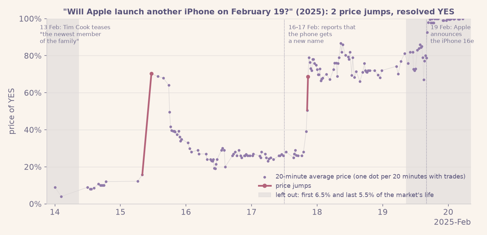
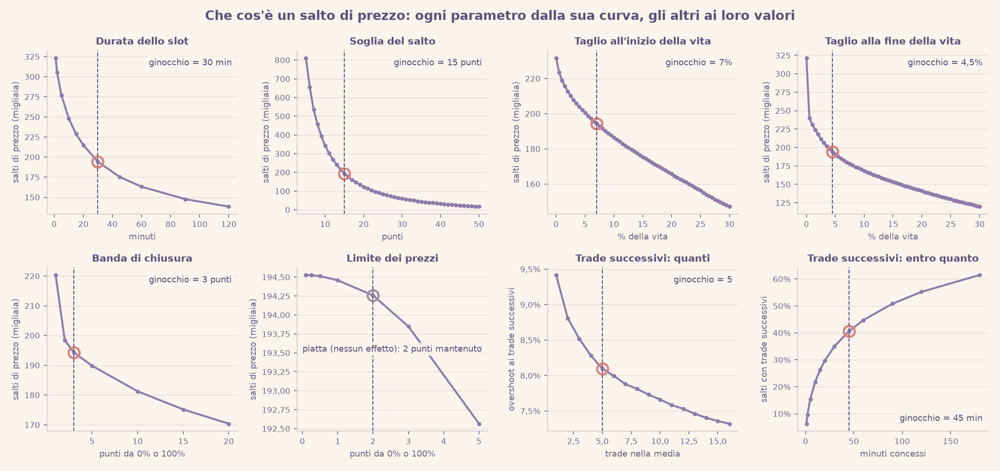
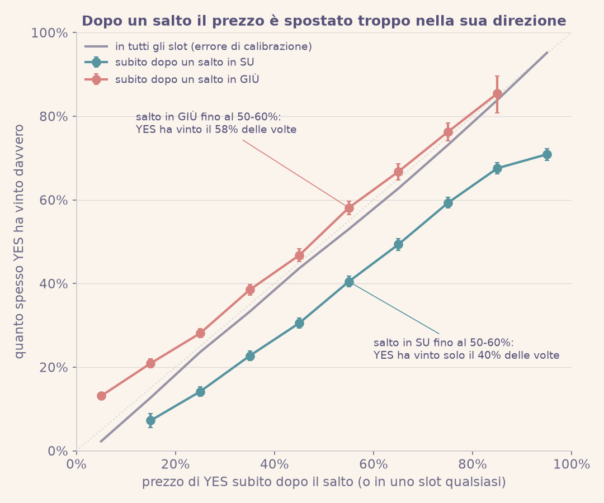
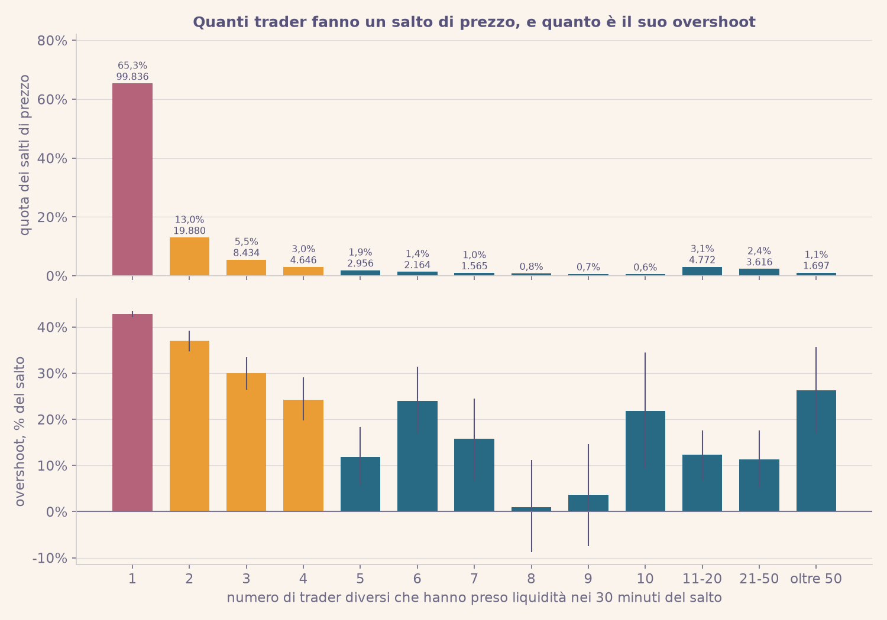
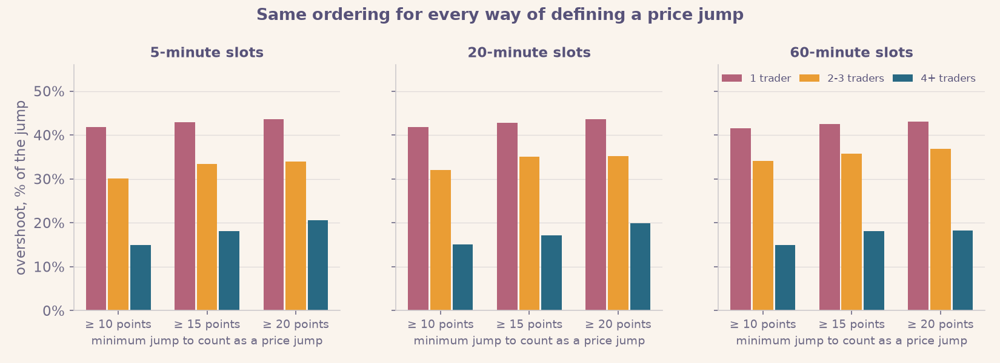
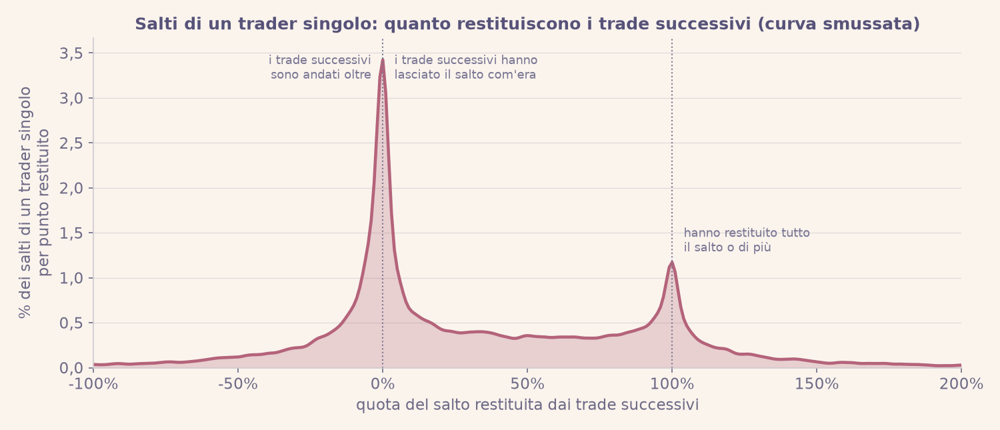
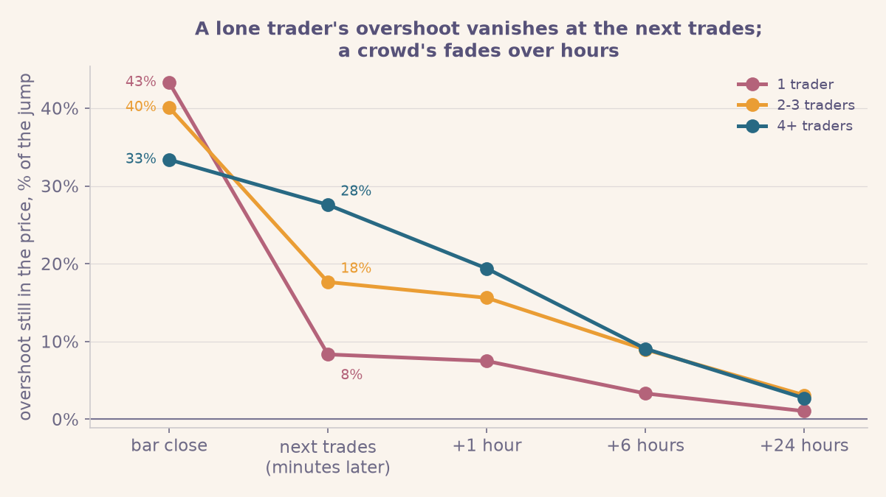
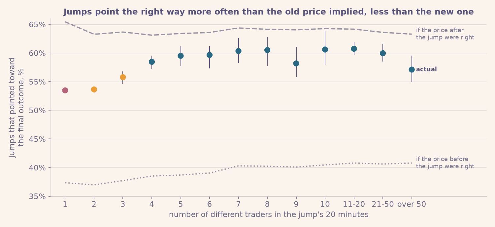
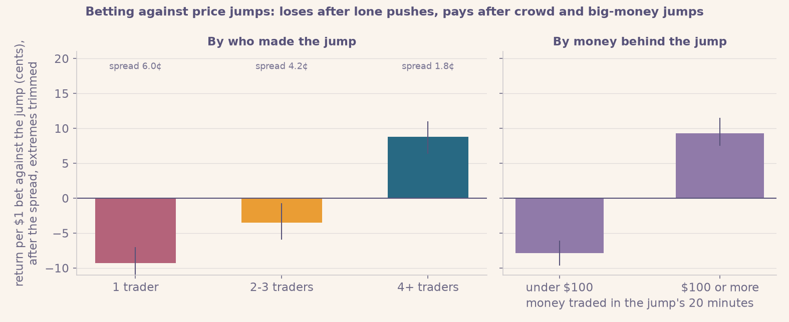

# Price jump su Polymarket: versione semplificata

*Analisi di 766 milioni di trade su Polymarket, da novembre 2022 a maggio 2026*

---

## 1. Contesto

Polymarket è un mercato di previsioni: si scommette su un evento comprando quote che pagano
$1 se l'evento accade (YES) e $0 se non accade (NO). Il prezzo di una quota, tra 0% e 100%, è
quindi la probabilità che il mercato assegna all'evento.

Abbiamo usato tutti i trade di Polymarket da novembre 2022 a maggio 2026: 766 milioni di trade
in circa un milione di mercati. Ogni trade ha un orario, un prezzo, un importo in dollari e i
due wallet coinvolti. L'analisi riguarda i mercati su eventi (politica, sport, economia,
cultura, ecc.), circa 440.000 mercati; i mercati crypto "up or down" sono trattati a parte
(sezione 5).

La domanda è una sola: **quando il prezzo fa un salto improvviso, quanto di quel salto era
giustificato, alla luce di come il mercato si è poi risolto?**

---

## 2. Price jump e overshoot

### Price jump

I trade vengono raggruppati in intervalli (**slot**) di 20 minuti. Il prezzo di uno slot è la
media dei prezzi dei suoi trade, pesata per i dollari (VWAP):

$$p_s = \frac{\sum_{i \in s} u_i \, y_i}{\sum_{i \in s} u_i}$$

dove $y_i$ è il prezzo YES del trade $i$ e $u_i$ il suo importo in dollari.

Uno slot è un **price jump** se il suo prezzo dista almeno **15 punti percentuali** da quello
dello slot precedente con trade:

$$|p_s - p_{s^-}| \ge 15 \text{ punti}$$

Di ogni mercato si escludono il primo 6,5% della vita (il prezzo si sta ancora formando) e
l'ultimo 5,5% (la corsa finale verso 0% o 100%, che fanno tutti i mercati).

**Esempio.** *"Will Apple launch another iPhone on February 19?"* (2025). Il 15 febbraio un
solo trader porta il prezzo dal 16% al 70% senza notizie; altri trader lo riportano al 25%
entro lunedì. Il 17 febbraio, dopo le indiscrezioni su un nuovo nome, più trader lo portano
dal 28% a circa il 70%, e il prezzo regge. Il 19 Apple annuncia l'iPhone 16e e il mercato si
risolve YES. I punti rossi sono i due price jump; le zone grigie sono le parti escluse.

### Overshoot

L'**overshoot** è la parte del jump che l'esito finale non ha giustificato. Su un solo mercato
non si può misurare (l'esito è 0 o 1), ma su migliaia sì:

1. si prendono tutti i jump finiti, per esempio, al 60%;
2. se quei prezzi fossero giusti, YES dovrebbe vincere il 60% delle volte;
3. se YES vince solo il 53% delle volte, i prezzi erano 7 punti troppo alti;
4. per un jump di 20 punti (dal 40% al 60%), l'overshoot è 7 / 20 = **35% del jump**.

I prezzi sono leggermente sbagliati anche nei momenti tranquilli, quindi questo errore abituale
$b(p)$, misurato in momenti casuali, viene sottratto prima. In formula, per un jump $j$ dal prezzo
$p_{j^-}$ al prezzo $p_j$, con esito $O_j$ (1 se ha vinto YES, 0 se NO) e direzione $d_j$ (+1 in
su, −1 in giù):

$$o_j = -\big[(O_j - p_j) - b(p_j)\big] \cdot d_j, \qquad \text{overshoot} = \frac{\sum_j o_j}{\sum_j |p_j - p_{j^-}|}$$

Un overshoot dello 0% significa che i jump erano giusti; del 100% che erano del tutto
ingiustificati; negativo che il prezzo non si era spinto abbastanza.

**Esempio con un jump.** Un jump in su al 60% in un mercato che si risolve NO, con errore
abituale −2 punti: $o = -[(0 - 0{,}60) - (-0{,}02)] \cdot 1 = 0{,}58$. Un jump uguale in un
mercato che si risolve YES dà $o = -0{,}42$. Solo la somma su molti jump è informativa.

Gli intervalli di incertezza (95%) si ottengono ricampionando interi mercati 150 volte.

---

## 3. Come sono stati scelti i parametri

Ogni parametro è stato scelto con il **metodo del gomito**: si disegna una curva su un ampio
intervallo di valori e si prende il punto in cui smette di cambiare rapidamente (il
"ginocchio", trovato con la regola Kneedle). I parametri che dipendono l'uno dall'altro sono
stati cercati insieme, finché nessun valore si spostava più.

| Parametro | Valore | Cosa misura la curva |
|---|---|---|
| Durata dello slot | **20 minuti** | quota di jump annullati dai trade successivi (rumore) |
| Soglia del jump | **15 punti** | numero di jump trovati |
| Taglio all'inizio della vita | **6,5%** | numero di jump trovati |
| Taglio alla fine della vita | **5,5%** | numero di jump trovati |
| Banda di chiusura | **3 punti** (3-97%) | numero di jump trovati |
| Trade successivi | **5 trade entro 45 minuti** | overshoot ai trade successivi / jump con trade successivi |
| Gruppi di trader | **1 / 2-3 / 4 o più** | overshoot dei jump con almeno K trader |
| Soglia dei soldi | **$100** | overshoot dei jump con almeno quella cifra |

La durata dello slot non si giudica dal numero di jump (slot più corti ne trovano sempre di
più), ma dal rumore: la quota di jump che i trade successivi riprendono per più di metà scende
dal 33% con slot di 1 minuto al 23% con slot di 2 ore, e il ginocchio è a 20 minuti.

---

## 4. Risultati

### 4.1 I price jump vanno troppo lontano di oltre un terzo

Su 165.435 price jump in 57.579 mercati con esito chiaro, il prezzo subito dopo il jump è
**troppo estremo del 36% del jump** (intervallo 35,2-36,3%). Il valore resta tra il 30% e il
41% in ogni categoria e in ogni anno.

Il grafico lo mostra senza formule. Dopo un jump in su verso il 60%, YES ha vinto solo il 44%
delle volte; dopo un jump in giù verso il 60%, il 63%; in un momento qualsiasi, un prezzo del
60% ha vinto il 58% delle volte. Dopo un jump il prezzo è spostato troppo nella direzione del
jump.

### 4.2 Quanti trader fanno un jump, e quanto va troppo lontano

Solo chi accetta un ordine già presente nel book (il *taker*) muove il prezzo. Per ogni jump
contiamo quanti wallet diversi hanno fatto da taker nei suoi 20 minuti.

**Distribuzione.** Il 67,4% dei jump è fatto da **un solo trader** (111.560 jump), il 12,6% da
due, il 5,3% da tre; il restante 15% si divide tra quattro trader e più, fino a qualche
centinaio.

**Overshoot.** Scende dal 43% con un trader al 37% con due, al 31% con tre e al 19% con
quattro. Da quattro in poi resta intorno al 15-27%, con intervalli ampi; insieme, i jump di 4 o
più trader (una "folla") vanno troppo lontano del 17%.

**Il risultato non dipende da come si definisce un jump.** Con slot di 5, 20 o 60 minuti e
soglie di 10, 15 o 20 punti, in tutte e nove le combinazioni i jump di un trader hanno un
overshoot del 42-44%, quelli di 2-3 trader del 30-37% e quelli di una folla del 15-21%.
L'ordine non cambia mai.

Anche le altre verifiche danno la stessa conclusione:
- **A parità di soldi.** Sotto i $100 nello slot: 41% per un trader contro 16% per una folla;
  sopra i $100: 38% contro 14%.
- **A parità di tutto il resto** (categoria, tipo di domanda, soldi, prezzo, tempo alla fine,
  durata del mercato, anno, direzione): la folla va troppo lontano di 17 punti in meno di un
  trader singolo, contro 24 punti senza controlli.
- **Non sono pochi wallet.** I 112.000 jump di un trader vengono da 52.000 wallet diversi.
- **Sport ed esport si comportano come gli altri mercati** (66.193 jump in 32.332 mercati): i
  jump di un trader vanno troppo lontano del 43% in entrambi, quelli di una folla del 18% nello
  sport e del 9% negli esport.

### 4.3 Jump di un solo trader: quanto viene restituito

Su un singolo jump l'overshoot rispetto all'esito non si può misurare: con un esito 0 o 1,
ogni jump risulta o molto giusto o molto sbagliato. Quello che si misura jump per jump è
**quanta parte del jump i trade successivi restituiscono**:

$$g_j = \frac{p_j - p^\text{next}_j}{p_j - p_{j^-}}$$

dove $p^\text{next}_j$ è il prezzo medio dei 5 trade successivi (entro 45 minuti). $g = 0$: il
jump è rimasto com'era; $g = 100\%$: è stato annullato del tutto; $g < 0$: il prezzo è andato
ancora oltre.

Per i 36.500 jump di un trader con trade successivi entro 45 minuti (il 33% del totale):
- il 30% è stato spinto ancora più in là;
- il 17% è rimasto com'era (0-10% restituito);
- il 36% ha perso almeno metà del jump, e il 16% tutto il jump o di più;
- il jump mediano restituisce il 15%; pesando per la dimensione, il 35%.

La curva ha due picchi: uno a 0% (jump confermati) e uno a 100% (jump annullati del tutto).
Il ritorno indietro non è quindi un piccolo calo di ogni jump: alcuni vengono cancellati,
altri tenuti.

**Quanto dura l'overshoot.** Per un trader singolo l'overshoot passa dal 43% all'**8% già ai
trade successivi** (in mediana 14 minuti dopo). Per una folla parte più basso (33%) ma resta:
28% ai trade successivi (2 minuti dopo), 19% dopo un'ora, 3% dopo un giorno.

La spinta di un trader singolo è soprattutto un effetto meccanico: un ordine attraversa un
book povero di offerte e i trader successivi riportano indietro il prezzo. L'overshoot di una
folla è invece una reazione eccessiva più lenta.

### 4.4 Accuratezza dei trader singoli

Un jump "ha ragione" se è salito e poi ha vinto YES, o è sceso e poi ha vinto NO. I jump di
**un solo trader** hanno avuto ragione nel **53,5%** dei casi. Per capire se è tanto o poco
servono due termini di paragone:
- se fosse stato giusto il prezzo *prima* del jump, avrebbero avuto ragione il **37,4%** delle
  volte;
- se fosse stato giusto il prezzo *dopo* il jump, il **65,4%**.

**Esempio.** 100 jump dal 40% al 60%: se fosse giusto il 40%, YES vincerebbe 40 volte; se
fosse giusto il 60%, 60 volte. Se vince 51 volte, il prezzo giusto era il 51%. Il jump ha fatto
20 punti, ma solo 11 (da 40 a 51) erano giustificati: il 55%. Gli altri 9 punti, il 45%, sono
troppo.

**Con i numeri reali**, il jump sposta l'attesa di 28 punti (da 37,4% a 65,4%), ma la realtà
si ferma al 53,5%: sono giustificati 16,1 punti su 28, il **57%**. Il restante 43% è l'overshoot
dei jump di un trader (sezione 4.2), visto da un altro lato.

Un trader singolo quindi porta informazione (il prezzo va nella direzione giusta più spesso di
quanto dicesse il prezzo vecchio), ma esagera. I jump di una **folla** hanno ragione nel 59,6%
dei casi (contro 39,8% e 63,7%): fanno l'**83%** della strada.

### 4.5 Scommettere contro i jump

Se i jump vanno troppo lontano, scommettere contro dovrebbe rendere. Ogni scommessa di prova
compra il lato opposto subito dopo il jump, al prezzo che si sarebbe davvero pagato, e lo tiene
fino alla fine. I risultati sono per $1 puntato, al netto dell'errore abituale, con l'1,5% dei
valori più estremi a ogni lato riportato al limite.

- **Contro i jump di un trader singolo si perde** circa 9 centesimi per $1 (intervallo 7-12):
  il prezzo torna indietro subito, ma lo spread tra prezzo di acquisto e di vendita (in mediana
  6,0 centesimi) si mangia il guadagno.
- **Contro i jump di una folla si guadagna** circa 9 centesimi per $1 (intervallo 6-11), con uno
  spread di soli 1,8 centesimi.
- **Contro i jump con almeno $100** si guadagnano circa 9 centesimi per $1 (intervallo 8-12).

Il grande overshoot dei trader singoli sparisce prima che qualcuno possa sfruttarlo; resta
sfruttabile quello più piccolo, ma più duraturo, delle folle. Commissioni e posizione in coda
non sono considerate: è un limite superiore.

---

## 5. Nota sui mercati crypto "up or down"

I mercati ricorrenti su bitcoin, ether, solana e xrp ("salirà nei prossimi 15 minuti?")
contengono il 59% di tutti i trade e hanno parametri propri, scelti con lo stesso metodo (slot
di 30 secondi, jump di almeno 16 punti): 51.172 jump in 33.586 mercati. Alla fine dei 30
secondi compare lo stesso schema (i trader singoli vanno troppo lontano, +17% nei mercati da 15
minuti; le folle continuano nella stessa direzione, −7% / −9%), ma pochi secondi dopo, ai trade
successivi, la differenza tra i gruppi sparisce.

---

## 6. In sintesi

- Dopo un price jump il prezzo va troppo lontano, in media del 36% del jump, in ogni categoria
  e in ogni anno.
- Due jump su tre sono fatti da un solo trader, spesso con pochi dollari. Questi vanno troppo
  lontano del 43%, ma l'eccesso viene quasi tutto restituito già dai trade successivi.
- I jump fatti da 4 o più trader vanno troppo lontano molto meno (17%), ma l'eccesso dura ore.
- Il risultato resta lo stesso cambiando la durata degli slot e la soglia del jump.
- Scommettere contro i jump di un trader singolo perde per colpa dello spread; contro quelli di
  una folla resta un piccolo margine, prima delle commissioni.
